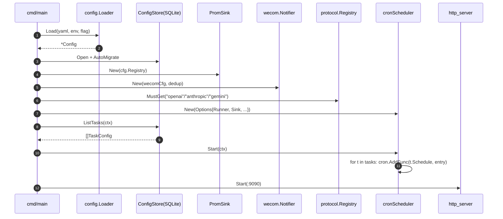
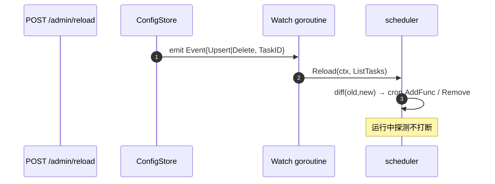
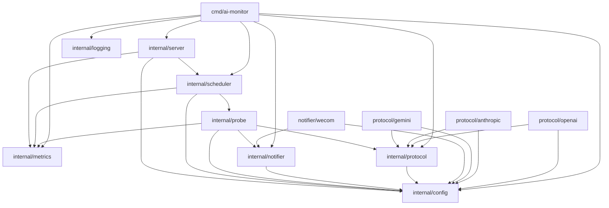
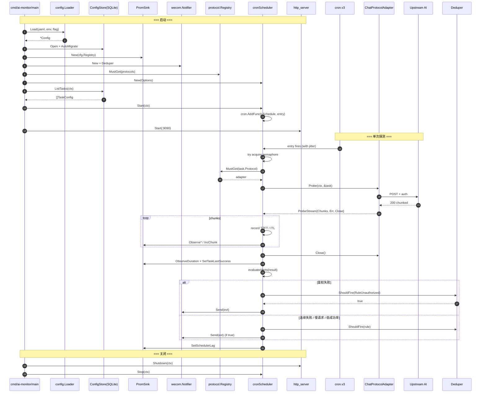
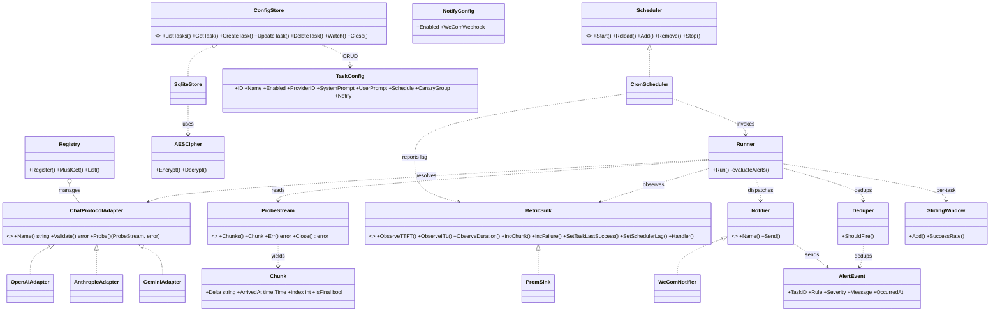

# AI 服务监控与指标统计系统 · 设计方案

> **状态**：设计方案（待用户审阅）
> **阶段**：第一阶段交付（实现前）
> **作者**：许清楚（PRD） + 高见远（架构设计 + 任务分解）
> **汇编**：齐活林（Qi）· 主理人
> **项目根**：`/Users/yangchun/code/gitlab/aibench/ai-monitor`
> **下一步**：用户确认设计后启动寇豆码（工程师）实现 → 严过关（QA）验证

---

## TL;DR

为多协议 AI 端点（OpenAI 兼容 / Anthropic / Gemini）提供**周期性拨测 + 流式时延统计（TTFT / ITL / 会话总时长）+ Prometheus 拉取指标 + 企业微信告警**的单实例 Go 服务。

---

## 目录

- [Part 1 · PRD（许清楚）](#part-1--prd许清楚)
  - [1. 默认技术栈与关键决策](#1-默认技术栈与关键决策)
  - [2. 任务配置字段表](#2-任务配置字段表)
  - [3. 指标 metric 清单](#3-指标-metric-清单)
  - [4. 接口契约（PRD 草签）](#4-接口契约prd-草签)
  - [5. 通知触发规则](#5-通知触发规则)
  - [6. 假设清单（⚠️ 审阅重点）](#6-假设清单-审阅重点)
  - [7. 非目标](#7-非目标)
  - [8. 需求池（P0/P1/P2）](#8-需求池p0p1p2)
- [Part 2 · 架构设计（高见远）](#part-2--架构设计高见远)
  - [9. 最终技术选型（含 go.mod）](#9-最终技术选型含-gomod)
  - [10. 目录结构](#10-目录结构)
  - [11. 包与接口定义（Go 签名）](#11-包与接口定义go-签名)
  - [12. DB Schema](#12-db-schema)
  - [13. 关键流程时序图](#13-关键流程时序图)
  - [14. 模块依赖图](#14-模块依赖图)
  - [15. 实现任务列表](#15-实现任务列表)
  - [16. 跨文件共享约定](#16-跨文件共享约定)
  - [17. 待明确事项 + 风险](#17-待明确事项--风险)
- [附录 A · Mermaid 文件独立产物](#附录-a--mermaid-文件独立产物)

---

# Part 1 · PRD（许清楚）

## 1. 默认技术栈与关键决策

| # | 决策点 | 推荐方案 | 理由 | 替代项 |
|---|---|---|---|---|
| 1 | 配置存储 | **SQLite + GORM** | 任务需要增删改查 + 状态字段 + 审计；单实例零运维；GORM 提供 AutoMigrate 与类型安全 | YAML（静态、轻量、缺事务与运行时变更）；MySQL（多实例协作才需要） |
| 2 | 任务调度 | **robfig/cron v3 + goroutine + 信号量** | 主流库、秒级 cron、内置日志钩子；Go 生态首选 | cron v3 官方包（API 较新）；自研 ticker（需自实现解析与持久化） |
| 3 | 指标采集与上报 | 流式 chunk 回调 → **prometheus/client_golang pull 模式** | 流式天然支持增量；pull 是 Prometheus 标准做法、进程常驻场景契合 | pushgateway（短生命周期任务适用）；OTel exporter（本期不必要） |
| 4 | 多协议可扩展 | **ProtocolAdapter interface + 注册表** | Go 接口天然支持多实现；注册表新增协议零侵入；schema 与协议解耦 | switch on type（紧耦合）；策略模式 + 工厂（样板代码多） |
| 5 | 通知触发 | 连续失败 + 单次慢 + 滑窗成功率三组合 + 去抖 | 单一阈值易抖动；三组合覆盖三类异常 | 仅 HTTP 错误码（漏掉劣化）；纯成功率（漏掉单次严重延迟） |

> 实现语言：**Go 1.25.x**（默认）；请求模式：**强制流式**（ITL 必须从流式 chunk 计算）。

---

## 2. 任务配置字段表

**标记说明**：🌐 公共字段 ｜ 🔌 协议相关字段

| 字段名 | 类型 | 必填 | 默认值 | 说明 | 示例 |
|---|---|---|---|---|---|
| 🌐 id | string (uuid) | 自动生成 | — | 任务唯一标识 | `task-7f3a` |
| 🌐 name | string | 是 | — | 任务显示名，唯一索引 | `prod-gpt4o-probe` |
| 🌐 enabled | bool | 否 | true | 是否启用 | `true` |
| 🌐 protocol | enum | 是 | — | `openai` / `anthropic` / `gemini` | `openai` |
| 🌐 base_url | string | 是 | — | AI 服务 base URL（`url` 校验） | `https://api.openai.com` |
| 🌐 insecure_skip_verify | bool | 否 | false | 跳过上游 TLS 证书校验（自签名 / 私有 CA 场景）；⚠️ 关闭 MITM 防护 | `true` |
| 🌐 apikey | string (secret) | 是 | — | 鉴权密钥（DB 加密） | `sk-...` |
| 🌐 model | string | 是 | — | 模型名 | `gpt-4o` |
| 🌐 system_prompt | string | 否 | "" | 系统提示，支持 `${var}` | `You are a helpful assistant.` |
| 🌐 user_prompt | string | 是 | — | 用户提示，支持 `${timestamp}` 等变量 | `Say hi at ${timestamp}` |
| 🌐 prompt_vars | map[string]string | 否 | {} | 变量注入映射 | `{"timestamp": "{{.NowRFC3339}}"}` |
| 🌐 schedule | string | 是 | — | cron 表达式（秒级 6 位） | `*/30 * * * * *` |
| 🌐 timeout | duration | 否 | 30s | 单次探测总超时（1s~10m） | `30s` |
| 🌐 notify.enabled | bool | 否 | true | 是否启用通知 | `true` |
| 🌐 notify.channel | enum | 否 | wecom | 通知渠道（本期仅 wecom） | `wecom` |
| 🌐 notify.wecom_webhook | string (secret) | 条件 | — | 企业微信群机器人 webhook（DB 加密） | `https://qyapi.weixin.qq.com/cgi-bin/webhook/send?key=xxx` |
| 🔌 openai.stream_path | string | 否 | `/v1/chat/completions` | OpenAI 流式端点 | `/v1/chat/completions` |
| 🔌 openai.extra_headers | map[string]string | 否 | {} | 自定义请求头 | `{"X-Trace": "1"}` |
| 🔌 anthropic.max_tokens | int | 否 | 1024 | Anthropic 必填 max_tokens（1~200000） | `64` |
| 🔌 gemini.alt | string | 否 | `sse` | Gemini 流式参数（`sse` / `ndjson`） | `sse` |

> 协议段说明：openai/anthropic/gemini 三段根据 `protocol` 字段**互斥启用**；ProtocolAdapter 负责 schema 校验。
> apikey + webhook 用 AES-GCM 加密落 DB，主密钥由 env / flag 注入。

---

## 3. 指标 metric 清单

| Metric 名 | 类型 | 单位 | Labels | Bucket / 用途 |
|---|---|---|---|---|
| `ai_probe_request_duration_seconds` | Histogram | s | `task_id, protocol, model, status` | buckets `[.1, .25, .5, 1, 2, 5, 10, 20, 30, 60]` 会话总时长分布 |
| `ai_probe_ttft_seconds` | Histogram | s | `task_id, protocol, model` | `[.05, .1, .25, .5, 1, 2, 5, 10]` 首 token 延迟分布 |
| `ai_probe_itl_seconds` | Histogram | s | `task_id, protocol, model` | `[.01, .025, .05, .1, .25, .5, 1]` 相邻 token 间隔 |
| `ai_probe_request_total` | Counter | — | `task_id, protocol, model, status` | 探测总次数 |
| `ai_probe_failure_total` | Counter | — | `task_id, protocol, model, error_type` | 失败细分（timeout / 4xx / 5xx / protocol_error） |
| `ai_probe_chunk_total` | Counter | — | `task_id, protocol, model` | 累计接收 chunk 数 |
| `ai_probe_task_last_success_timestamp_seconds` | Gauge | s | `task_id` | 最近一次成功时间（探活 / 看板） |
| `ai_probe_scheduler_lag_seconds` | Gauge | s | `task_id` | 调度延迟（实际执行时间 - 计划时间） |

> **Label cardinality 建议**：`task_id` ≤ 100 量级；`error_type` 用枚举非原始错误文本。
> **Layout 选型**：单实例单任务维度安全；可后续拆分 `task_id` 为 `<protocol>.<model>` 哈希以减小 series。

---

## 4. 接口契约（PRD 草签）

```text
ChatProtocolAdapter
  Name() string
  Validate(cfg TaskConfig) error
  Probe(ctx, cfg) ProbeStream

ProbeStream
  Chunks() <-chan Chunk    // 每个 chunk 带 ArrivedAt + payload
  Err() error              // 流结束时返回最终错误
  Close() error            // 释放连接

ConfigStore
  ListTasks / GetTask / CreateTask / UpdateTask / DeleteTask
  Watch(ctx) <-chan Event  // P1：变更通知

Notifier
  Name() string
  Send(ctx, AlertEvent) error

MetricSink
  ObserveTTFT / ObserveITL / ObserveDuration
  IncFailure / IncChunk
```

> 详细方法签名见 Part 2 §11。

---

## 5. 通知触发规则

| 规则 | 默认阈值 | 理由 |
|---|---|---|
| 连续失败 | 同一任务连续 N=3 次失败 | 容忍偶发抖动；3 次足以确认非随机 |
| 单次严重慢请求 | 会话总时长 > 20s 或 TTFT > 10s | 远超 P99 即视为劣化 |
| 滑窗成功率 | 5 分钟窗口成功率 < 80%（样本 ≥ 20） | 持续劣化但未完全失败 |
| 鉴权失败 | 401 / 403 立即告警（不经连续阈值） | 凭据问题不容缓冲 |
| 通知去抖 | 同一 task_id+rule 5 分钟内仅触发一次 | 避免告警风暴 |
| 恢复通知 | 触发过的任务恢复后发一次 OK（P1） | 闭环 |

> 所有阈值均落地为配置项，**默认配置见 §9 选型表**，用户审阅时可调。

---

## 6. 假设清单（⚠️ 审阅重点）

| # | 假设 | 备选 / 推翻路径 |
|---|---|---|
| A1 | 配置落 SQLite（非 YAML / MySQL） | 改 YAML / MySQL |
| A2 | Prometheus **pull** 模式（非 pushgateway） | 改 pushgateway |
| A3 | 调度最小粒度到**秒**（cron 6 位） | 改 5 位标准 cron |
| A4 | 最大并发探测数 = **16** | 按需调整 |
| A5 | apikey / webhook 在 DB 内 **AES-GCM** 加密 | 可接 KMS |
| A6 | 本期只做**企业微信**一种通知 | 钉钉 / Slack 走 P2 |
| A7 | 历史探测结果不长期存储 | 加 ring buffer |
| A8 | **单实例**部署，不考虑 HA / leader election | 拆调度与执行 |
| A9 | 二进制 + Docker 发布，不打包 Helm | — |
| A10 | ITL 强制要求流式；若协议仅非流式则**降级**——只统计 duration | 转告用户该协议不可用 |

---

## 7. 非目标

- ❌ 不做告警规则引擎（交给 Prometheus Alertmanager）
- ❌ 不做长链路 trace 关联（不接 OTel trace）
- ❌ 不做 dashboard / 可视化（交给 Grafana）
- ❌ 不做多租户 / RBAC
- ❌ 不做云原生自动扩缩
- ❌ 不做协议层代理（只拨测，不转发业务流量）
- ❌ 不做对话式评测 / 答案质量打分

---

## 8. 需求池（P0/P1/P2）

### P0（必须有）
- 三种协议（OpenAI / Anthropic / Gemini）流式探测
- 任务配置 CRUD（SQLite 持久化）
- cron 秒级调度 + 多任务并发 + 并发上限保护
- TTFT / ITL / 会话总时长采集 + Prometheus pull
- 异常通知（企业微信）
- `/metrics` + `/healthz`

### P1（强烈建议）
- 任务启用 / 禁用热切换（无需重启）
- 协议 adapter 配置校验（启动 + 保存双重校验）
- 通知去抖（5min）
- 优雅关闭（drain in-flight）
- 结构化日志（task_id / duration / status 全链路）

### P2（可选）
- **P2-A · Web UI 任务管理**：`deploy/admin-ui.html`（单文件 HTML + Vue 3 CDN）已提供；零后端改动可读 + reload。要"新建/删除"需补 POST / PATCH / DELETE `/admin/tasks` 路由（apikey/webhook 在后端做 AES-GCM 加密后入库）。
- 配置文件导入 / 导出
- 多通知渠道（钉钉 / Slack / Email）
- Pushgateway 模式
- OTel exporter

---

# Part 2 · 架构设计（高见远）

## 9. 最终技术选型（含 go.mod）

| 技术项 | 选型 | 版本 | 理由 / 风险 |
|---|---|---|---|
| 语言 | Go | 1.25.x | slog/slices/maps 标准库齐全；单二进制发布 |
| HTTP 路由 | 标准库 `net/http` + `http.ServeMux` (Go 1.22+ pattern) | stdlib | 固定 3 路由无需框架；零依赖 |
| SQLite 驱动 | `glebarez/sqlite` | v1.11.0 | pure-Go、无 CGO；交叉编译友好 |
| ORM | `gorm.io/gorm` | v1.25.10 | AutoMigrate 省迁移脚本 |
| Cron | `robfig/cron/v3` | v3.0.1 | 秒级支持 + SkipIfStillRunning |
| 并发控制 | `golang.org/x/sync/semaphore` | v0.7.0 | 容量 16；轻量 |
| Prometheus | `prometheus/client_golang` | v1.19.1 | HistogramVec + 自定义 registry |
| 日志 | stdlib `log/slog`（JSON handler） | Go 1.22+ | 零依赖；结构化字段易采集 |
| YAML 解析 | `gopkg.in/yaml.v3` | v3.0.1 | 启动合并 DB 任务配置 |
| 配置校验 | `go-playground/validator/v10` | v10.22.0 | struct tag 校验 |
| UUID | `google/uuid` | v1.6.0 | task_id |
| 加密 | stdlib `crypto/aes` + `cipher.AEAD` | stdlib | AES-256-GCM |
| HTTP 客户端 | stdlib `net/http` | stdlib | SSE 友好 |
| 测试 | stdlib + `stretchr/testify` | v1.9.0 | 断言 |
| Mock | 优先 `httptest.Server`；可备 `go.uber.org/mock` | v0.5.0 | 真实 mock 优先 |

### 完整 `go.mod`

```go
module github.com/angryang/ai-monitor

go 1.25

require (
    github.com/glebarez/sqlite v1.11.0
    github.com/go-playground/validator/v10 v10.22.0
    github.com/google/uuid v1.6.0
    github.com/prometheus/client_golang v1.19.1
    github.com/robfig/cron/v3 v3.0.1
    github.com/stretchr/testify v1.9.0
    go.uber.org/mock v0.5.0
    golang.org/x/sync v0.7.0
    gopkg.in/yaml.v3 v3.0.1
    gorm.io/gorm v1.25.10
)
```

**未引入**：chi/echo/gin（路由太轻）、zap/logrus（slog 够）、migrate 库（GORM AutoMigrate 够）、viper（yaml+env+flag 三层手动合并）。

**默认参数**：`MaxConcurrent=16`、`SlowThreshold=10s`、`ConsecFailureN=3`、`SuccessRateWindow=200` 样本、`SuccessRateThreshold=0.8`、`DedupTTL=5min`、`Jitter=250ms`、`HTTPAddr=:9090`。

---

## 10. 目录结构

```
ai-monitor/
├── cmd/
│   └── ai-monitor/
│       └── main.go                  # 装配入口：唯一装配点
├── internal/
│   ├── config/
│   │   ├── task.go                  # TaskConfig + 子结构 + 校验
│   │   ├── store.go                 # ConfigStore 接口、Event、Watch
│   │   ├── store_sqlite.go          # GORM 实现 + AutoMigrate
│   │   ├── crypto.go                # AES-GCM 加解密
│   │   └── loader.go                # yaml < env < flag 合并
│   ├── protocol/
│   │   ├── adapter.go               # ChatProtocolAdapter / ProbeStream / Chunk / AlertEvent
│   │   ├── registry.go              # Register / MustGet / List
│   │   ├── openai/                  # OpenAI SSE 流式
│   │   ├── anthropic/               # Anthropic event-stream
│   │   └── gemini/                  # Gemini streamGenerateContent
│   ├── metrics/
│   │   ├── sink.go                  # MetricSink 接口
│   │   └── prom.go                  # PromSink + 自定义 *prometheus.Registry
│   ├── notifier/
│   │   ├── notifier.go              # Notifier 接口 + AlertEvent + MultiNotifier
│   │   ├── dedup.go                 # 5min 去抖
│   │   └── wecom/                   # 企业微信实现
│   ├── probe/
│   │   ├── runner.go                # 编排：adapter→chunk→sink→notifier
│   │   ├── sliding.go               # 滑动窗口成功率
│   │   └── rules.go                 # 4 条告警规则判定
│   ├── scheduler/
│   │   ├── scheduler.go             # Scheduler 接口
│   │   ├── cron.go                  # cron v3 + semaphore + jitter
│   │   └── reload.go                # 热加载（P1）
│   ├── server/
│   │   └── http.go                  # /metrics / /healthz / /admin
│   └── logging/
│       └── slog.go                  # 初始化 + 字段中间件
├── deploy/
│   ├── example.config.yaml
│   ├── prometheus-alerts.yaml
│   └── Dockerfile                   # 多阶段 CGO_ENABLED=0 scratch 镜像
├── Makefile                         # build / test / lint / run / docker
├── go.mod
├── go.sum
└── README.md
```

**职责约束**：
- `cmd/ai-monitor/main.go` 唯一装配入口，禁业务逻辑
- `internal/` 不可被外部 import
- 包名小写无下划线；文件名小写下划线
- 测试文件与被测文件同包同目录

---

## 11. 包与接口定义（Go 签名）

### 11.1 `internal/protocol/adapter.go`

```go
package protocol

// X-Req-Id 是 ai-monitor 在每个 outbound 请求上携带的唯一标识，便于
// 出问题时按 request id 在 AI 服务器侧日志定位。详见 §11.6.3。
const RequestIDHeader = "X-Req-Id"

// GenerateRequestID 给 req 注入 X-Req-Id（若已存在则保留）。generator
// 可注入测试场景；默认走 uuid.NewString。生成结果返回便于调用方落日志。
func GenerateRequestID(req *http.Request, generator func() string) string { ... }

// Chunk 单个流式片段。
type Chunk struct {
    Delta     string    // 增量文本
    ArrivedAt time.Time // 到达本进程的时刻（用于 ITL/TTFT 计算）
    Index     int       // 自增，从 0
    IsFinal   bool      // 是否为终止帧
}

type ProbeStream interface {
    Chunks() <-chan Chunk   // Adapter 在内部 goroutine 写入；Close 或 ctx 取消后必须关闭
    Err() error             // 流结束后返回首个非 nil 错误
    Close() error           // 释放连接；幂等
}

type ChatProtocolAdapter interface {
    Name() string                                   // "openai" / "anthropic" / "gemini"
    Validate(cfg *config.TaskConfig) error           // 校验协议段配置
    Probe(ctx context.Context, cfg *config.TaskConfig) (ProbeStream, error)
}

var (
    ErrUnauthorized = errors.New("protocol: unauthorized")          // 401/403，即时告警
    ErrProtocolCfg  = errors.New("protocol: config invalid")        // 配置错误
    ErrUpstreamDown = errors.New("protocol: upstream unavailable")  // 网络/DNS/超时
)
```

### 11.2 `internal/protocol/registry.go`

```go
type AdapterFactory func(deps AdapterDeps) ChatProtocolAdapter

type AdapterDeps struct {
    HTTPClient *http.Client
    UserAgent  string
}

func Register(name string, f AdapterFactory)   // 同名重复 panic
func MustGet(name string, deps AdapterDeps) ChatProtocolAdapter
func List() []string
```

### 11.3 `internal/config/task.go`

> §18.17 增量后：上游坐标全部移出任务，`TaskConfig` 只保留自身字段 +
> `provider_id`；协议 / 地址 / 密钥 / 模型 / 超时 / TLS / thinking /
> 协议块变成运行期字段（`gorm:"-"`），由 `provider.Binder` 在探测前填入。

```go
type Protocol string
const (
    ProtocolOpenAI    Protocol = "openai"
    ProtocolAnthropic Protocol = "anthropic"
    ProtocolGemini    Protocol = "gemini"
)

type NotifyChannel string
const NotifyWeCom NotifyChannel = "wecom"

type TaskConfig struct {
    ID           string            `gorm:"primaryKey;size:64"`
    Name         string            `gorm:"uniqueIndex;size:128;not null" validate:"required,min=1,max=128"`
    Enabled      bool              `gorm:"not null;default:true"`
    ProviderID   string            `gorm:"column:provider_id;size:64;index;not null"` // -> ai_providers.id
    // --- 以下全部是运行期字段（gorm:"-"），探测前由 provider.Binder 填入 ---
    Protocol          Protocol          `gorm:"-"`
    BaseURL           string            `gorm:"-"`
    APIKey            string            `gorm:"-"`
    APIKeyEnc         []byte            `gorm:"-"`
    Model             string            `gorm:"-"`
    InsecureSkipVerify bool             `gorm:"-"`
    ThinkingEnabled   bool              `gorm:"-"`
    Timeout           time.Duration     `gorm:"-"`
    TimeoutMS         int64             `gorm:"-"`
    OpenAI            *OpenAIConfig     `gorm:"-"`
    Anthropic         *AnthropicConfig  `gorm:"-"`
    Gemini            *GeminiConfig     `gorm:"-"`
    // --- 任务自身字段 ---
    SystemPrompt string            `gorm:"type:text"`
    UserPrompt   string            `gorm:"type:text" validate:"required"`
    PromptVars   map[string]string `gorm:"-"`           // JSON
    PromptVarsJSON string          `gorm:"column:prompt_vars;type:text"`
    Schedule     string            `gorm:"size:128;not null" validate:"required"` // cron 6 位
    CanaryGroup  string            `gorm:"size:64;not null;default:default"`
    Notify       NotifyConfig      `gorm:"embedded"`
    CreatedAt    time.Time         `gorm:"autoCreateTime"`
    UpdatedAt    time.Time         `gorm:"autoUpdateTime"`
}

// 通知开关用独立列名：否则 embedded 的 Enabled 会和 TaskConfig.Enabled
// 抢同一个 `enabled` 列，通知开关实际从未落库。
type NotifyConfig struct {
    Enabled         bool          `gorm:"column:notify_enabled;not null;default:false"`
    Channel         NotifyChannel `gorm:"column:notify_channel;size:32;not null;default:wecom" validate:"omitempty,oneof=wecom"`
    WeComWebhook    string        `gorm:"-"`
    WeComWebhookEnc []byte        `gorm:"column:notify_wecom_webhook_enc;type:blob"`
}

type OpenAIConfig struct {
    StreamPath        string `gorm:"size:256" validate:"omitempty,startswith=/"`
    ExtraHeadersJSON  string `gorm:"column:openai_extra_headers;type:text"` // JSON 序列化
}

type AnthropicConfig struct {
    MaxTokens        int    `gorm:"not null;default:1024" validate:"min=1,max=200000"`
    ExtraHeadersJSON string `gorm:"column:anthropic_extra_headers;type:text"` // JSON 序列化；用于灰度/Canary 路由头
}

type GeminiConfig struct {
    Alt              string `gorm:"size:32;not null;default:sse" validate:"omitempty,oneof=sse ndjson"`
    ExtraHeadersJSON string `gorm:"column:gemini_extra_headers;type:text"`   // JSON 序列化；用于灰度/Canary 路由头
}
```

### 11.4 `internal/config/store.go`

```go
type EventType string
const (
    EventUpsert EventType = "upsert"
    EventDelete EventType = "delete"
)

type Event struct {
    Type   EventType
    TaskID string
    At     time.Time
}

type ConfigStore interface {
    ListTasks(ctx context.Context) ([]TaskConfig, error)
    GetTask(ctx context.Context, id string) (*TaskConfig, error)
    CreateTask(ctx context.Context, t *TaskConfig) error
    UpdateTask(ctx context.Context, t *TaskConfig) error
    DeleteTask(ctx context.Context, id string) error
    Watch(ctx context.Context) (<-chan Event, error)  // P1：变更订阅
    Close() error
}

var (
    ErrNotFound      = errors.New("config: not found")
    ErrAlreadyExists = errors.New("config: already exists")
    ErrInvalidConfig = errors.New("config: invalid")
)
```

### 11.5 `internal/config/crypto.go`

```go
type Cipher interface {
    Encrypt(plaintext []byte) ([]byte, error)
    Decrypt(ciphertext []byte) ([]byte, error)
}

type AESCipher struct{ aead cipher.AEAD }

func NewAESCipher(masterKey []byte) (*AESCipher, error)  // masterKey 必须 32 字节
func (c *AESCipher) Encrypt(plaintext []byte) ([]byte, error)
func (c *AESCipher) Decrypt(ciphertext []byte) ([]byte, error)
// 落盘格式：nonce(12) || ciphertext || tag(16)
```

### 11.6 `internal/metrics/sink.go`

```go
type MetricSink interface {
    ObserveTTFT(taskID, protocol, model string, seconds float64)
    ObserveITL(taskID, protocol, model string, seconds float64)
    ObserveDuration(taskID, protocol, model, status string, seconds float64)
    IncChunk(taskID, protocol, model string, n int)
    IncFailure(taskID, protocol, model, errorType string)
    SetTaskLastSuccess(taskID string, ts time.Time)
    SetSchedulerLag(seconds float64)
    Handler() http.Handler
}
```

**PromSink 内部 8 指标**（独立 `*prometheus.Registry`，避免重复注册）：
- `ai_probe_request_duration_seconds`（HistogramVec {task_id, protocol, model, status}）
- `ai_probe_ttft_seconds`（HistogramVec {task_id, protocol, model}）
- `ai_probe_itl_seconds`（HistogramVec {task_id, protocol, model}）
- `ai_probe_request_total`（CounterVec {task_id, protocol, model, status}）
- `ai_probe_failure_total`（CounterVec {task_id, protocol, model, error_type}）
- `ai_probe_chunk_total`（CounterVec {task_id, protocol, model}）
- `ai_probe_task_last_success_timestamp_seconds`（GaugeVec {task_id}）
- `ai_probe_scheduler_lag_seconds`（Gauge）

默认 Histogram buckets：`{.005, .01, .025, .05, .1, .25, .5, 1, 2.5, 5, 10, 30}`。

**11.6.1（用户问题触发的设计补丁）— 分位数计算与 buckets 优化**

Histogram 类型原生支持 PromQL 的 `histogram_quantile(quantile, sum by (le) (rate(...[5m])))` 计算 P50/P90/P95/P99 趋势图，配套 Grafana Dashboard 见 `deploy/grafana-llm-dashboard.json`。

但默认单套 buckets 在以下场景精度不足，建议在 P1-D 拆分：

| 指标 | 推荐 buckets | 理由 |
|---|---|---|
| `ai_probe_ttft_seconds` | `{.01, .025, .05, .1, .2, .35, .5, .75, 1, 2, 5}` | TTFT P99 通常 ≤ 1s，应在 1s 附近加密 |
| `ai_probe_itl_seconds` | `{.005, .01, .025, .05, .1, .25, .5}` | ITL 期望 ≤ 50ms |
| `ai_probe_request_duration_seconds` | `{.1, .25, .5, 1, 2.5, 5, 10, 20, 30, 60, 120}` | 会话总时长在长上下文下 P99 可达 30s+ |
| `ai_probe_scheduler_lag_seconds` | 升级为 Histogram（沿用 `{.01, .05, .1, .5, 1, 5, 30, 60}`） | 便于 P95 调度延迟计算 |

**11.6.2 — 可选 label：`canary_group`**（与 §17.1 第 1 项联动）

若启用灰度流量测试，建议给所有 `*Vec` 指标加 label `canary_group string`，默认 `"default"`。灰度任务配置时设定该值（如 `"gray-2024q3"` / `"prod"`），PromQL 可直接 split 出对比曲线：

```promql
histogram_quantile(0.95,
  sum by (le, protocol, model, canary_group) (
    rate(ai_probe_ttft_seconds_bucket[5m])
  )
)
```

> Cardinality 影响：每个任务增加 1 个 label 维度，若 task_id < 100 量级可控。

### 11.6.3 — X-Req-Id 自动注入（用户需求触发的设计补丁）

**目标**：每次 probe 触发时携带唯一 `X-Req-Id` HTTP header，方便出问题时根据 request id 在 AI 服务器侧日志定位对应的拨测记录。

**实现**：
- `protocol.RequestIDHeader = "X-Req-Id"` 常量（`internal/protocol/adapter.go`）
- `protocol.GenerateRequestID(req, generator func() string) string` helper：
  - 若 req 已含 `X-Req-Id`（test 注入 / 用户 extras）→ 原样返回
  - 否则用 generator（默认 `uuid.NewString`，RFC 4122 v4）生成一个，set 到 req.Header，返回
  - generator 返回空字符串时会兜底用 uuid，不会让 header 在线上"空着"
- `AdapterDeps.RequestIDGenerator func() string`（`internal/protocol/registry.go`）— 测试可注入确定性 generator
- 三协议适配器（OpenAI / Anthropic / Gemini）在 `http.NewRequestWithContext` 后立刻、**在 `ApplyExtraHeaders` 之前**调用 `GenerateRequestID`

**优先级约定**：
1. 用户通过 `extra_headers` 显式给 `X-Req-Id` → 用户值生效（让上游 trace id 直接贯穿）
2. 否则 ai-monitor 自动注入 uuid v4
3. 用户只想用 ai-monitor 的 uuid，不传 extras 即可

**未来可加**（不属于本期）：
- 把 `req_id` 加进 slog logger context（与 `task_id` 同级），客户端日志可一行 grep
- alert `Meta["req_id"]` 让告警消息也带上
- 与 OpenTelemetry traceparent 协同（传递 `traceparent` 而非自造 `X-Req-Id`）

### 11.7 `internal/notifier/notifier.go`

```go
type AlertSeverity string
const (
    SeverityInfo     AlertSeverity = "info"
    SeverityWarning  AlertSeverity = "warning"
    SeverityCritical AlertSeverity = "critical"
)

type AlertRule string
const (
    RuleConsecFailure  AlertRule = "consecutive_failures"
    RuleSlowRequest    AlertRule = "slow_request"
    RuleSuccessRateLow AlertRule = "success_rate_below_80"
    RuleUnauthorized   AlertRule = "unauthorized_immediate"
)

type AlertEvent struct {
    TaskID     string
    TaskName   string
    Protocol   string
    Rule       AlertRule
    Severity   AlertSeverity
    Message    string
    OccurredAt time.Time
    Meta       map[string]string
}

type Notifier interface {
    Name() string
    Send(ctx context.Context, evt AlertEvent) error
}

type MultiNotifier struct{ notifiers []Notifier }  // P1 预留
```

### 11.8 `internal/notifier/dedup.go`

```go
type Deduper struct {
    ttl time.Duration
    mu  sync.Mutex
    m   map[string]time.Time
}

func NewDeduper(ttl time.Duration) *Deduper
func (d *Deduper) ShouldFire(key string, now time.Time) bool
// Dedup key = task_id + ":" + rule；5min 内仅触发一次
```

### 11.9 `internal/scheduler/scheduler.go`

```go
type Scheduler interface {
    Start(ctx context.Context) error
    Reload(ctx context.Context, tasks []config.TaskConfig) error  // P1
    Add(task config.TaskConfig) error
    Remove(taskID string) error
    Stop(ctx context.Context) error
}
```

### 11.10 `internal/scheduler/cron.go` 关键结构

```go
type cronScheduler struct {
    cron     *cron.Cron
    sem      *semaphore.Weighted
    runner   *probe.Runner
    sink     metrics.MetricSink
    logger   *slog.Logger
    jitter   time.Duration
    inflight sync.WaitGroup
}
```

### 11.11 `internal/probe/probe.go`

```go
type Result struct {
    TaskID    string
    TaskName  string
    Protocol  string
    Model     string
    StartedAt time.Time
    EndedAt   time.Time
    TTFT      time.Duration     // 0 表示无 chunk
    ITLSum    time.Duration
    ITLCount  int
    Chunks    int
    Status    string            // "success" / "failure" / "unauthorized"
    Err       error
}

type Runner struct {
    adapters                protocol.Registry
    sink                    metrics.MetricSink
    notifier                notifier.Notifier
    dedup                   *notifier.Deduper
    sliders                 sync.Map           // task_id -> *slidingWindow
    slowThreshold           time.Duration      // 默认 10s
    consecFailureN          int                // 默认 3
    successRateWindow       int                // 默认 200
    successRateThreshold    float64            // 默认 0.8
}

func (r *Runner) Run(ctx context.Context, t config.TaskConfig) Result
// 步骤：
//   1. registry.MustGet(t.Protocol)
//   2. adapter.Probe(ctx, &t) → ProbeStream
//   3. 读 Chunks：记录 TTFT / ITL
//   4. Close → 记录 Duration
//   5. sink.Observe* 上报
//   6. evaluateAlerts → notifier.Send
```

### 11.12 `internal/server/http.go`

```go
type Server struct { /* cfg + store + scheduler + sink + logger + http.Server */ }

func (s *Server) Start(ctx context.Context) error
func (s *Server) Shutdown(ctx context.Context) error

// 路由：
//   GET  /metrics         → sink.Handler()
//   GET  /healthz         → 200 / 503（DB ping + 最近 cron 触发时间）
//   GET  /admin/tasks     → store.ListTasks（dev bind）
//   POST /admin/reload    → scheduler.Reload（dev bind）
// 默认监听：:9090
```

### 11.13 `internal/probe/store.go` + `store_sqlite.go`（**§18.11 增量**）

> **背景**：P50/P90/P99 趋势图需要从聚合 Histogram 推算，但单点失败、上游 5xx 风暴、模型撤回等**「离散事件」**会淹没在 average 里。`ai_probe_request_total{status="failure"}` 只给累计数，看不到「5 分钟前哪一条 404 因为什么」。本节把每次探测的**实际结果**（status / error / TTFT / ITL / chunks / 时间戳）落 DB，让 admin 能按任务看历史。

```go
// Run 后立即写一行；Prune 在 Save 之后跑（crash-safe："略多" 比 "略少" 安全）。
type RunStore interface {
    Save(ctx context.Context, run *ProbeRun) error
    ListByTask(ctx context.Context, taskID string, limit int) ([]ProbeRun, error)
    Prune(ctx context.Context, keep int) error
    Close() error
}

// 一个 ProbeRun 就是一次探测的"行式"画像。
type ProbeRun struct {
    ID         int64     `gorm:"primaryKey;autoIncrement" json:"id"`
    TaskID     string    `gorm:"size:64;not null;index"        json:"task_id"`
    TaskName   string    `gorm:"size:128;not null"             json:"task_name"`  // 反范式：任务改名/删后历史仍可读
    Protocol   string    `gorm:"size:32;not null"              json:"protocol"`
    Model      string    `gorm:"size:128;not null"             json:"model"`
    Status     string    `gorm:"size:32;not null"              json:"status"`    // success / failure / unauthorized
    Err        string    `gorm:"type:text"                      json:"error,omitempty"`
    StartedAt  time.Time `gorm:"not null;index"                 json:"started_at"`
    EndedAt    time.Time `gorm:"not null"                       json:"ended_at"`
    DurationMS int64     `gorm:"not null"                       json:"duration_ms"`
    TTFTMS     int64                                          json:"ttft_ms"`
    ITLAvgMS   int64                                          json:"itl_avg_ms"`
    ITLCount   int                                            json:"itl_count"`
    Chunks     int      `gorm:"not null"                       json:"chunks"`
}

// 关键设计：probe 包用 FromResult(Result) ProbeRun 做适配，
// 不让 probe 包 import GORM 类型，runner 也不持有 DB handle。
```

**SqliteRunStore**（`internal/probe/store_sqlite.go`）：

- 共享 `config.SqliteStore.DB()` 的 `*gorm.DB` handle —— 不重开文件，避免 WAL / lock 冲突
- `AutoMigrate` 在 main 启动时跑一次，GORM 只在 schema 不一致时写 `CREATE TABLE`
- `ListByTask` 默认 `limit=20`，上限 `100`，SQL: `ORDER BY started_at DESC, id DESC LIMIT N`（id 是同毫秒平局兜底）
- `Prune` 用 window function 一次性扫描所有任务，per-task 保留最新 N 条：
  ```sql
  DELETE FROM probe_runs
  WHERE id NOT IN (
    SELECT id FROM (
      SELECT id, ROW_NUMBER() OVER (
        PARTITION BY task_id
        ORDER BY started_at DESC, id DESC
      ) AS rn
      FROM probe_runs
    ) WHERE rn <= :keep
  )
  ```
  默认 `keep=100`（30s schedule × 100 ≈ 50 分钟窗口）

**与 runner 的接线**：

```go
func (r *Runner) Run(ctx context.Context, t config.TaskConfig) Result {
    res := Result{...}
    // 关键：defer **传指针**——`defer f(args)` 在 defer 语句处按值求值，
    // 传 res 值会拿到零值 Result。传 &res，deferred 调用能看到全部字段。
    defer r.persistRun(&res)
    // ... 探测逻辑 ...
    return res
}

func (r *Runner) persistRun(res *Result) {
    if r.RunStore == nil { return }
    run := FromResult(*res)
    ctx, cancel := context.WithTimeout(context.Background(), 2*time.Second)
    defer cancel()
    r.RunStore.Save(ctx, &run)         // 错误仅 log，不影响 cron 下一次 tick
    r.RunStore.Prune(ctx, r.RunRetention)
}
```

> **错误裁剪**：`r.Err.Error()` 截到 4096 字符。网络错误可能含整个 HTML body（几 KB），避免 SQLite text 列无限增长。

**新端点**：

```
GET /admin/tasks/{id}/runs?limit=20
→ 200 {"runs": [ProbeRun, ProbeRun, ...]}      # 新→旧
→ 404 task_not_found                          # id 不存在
→ 400 bad_limit                               # limit 不是正整数
→ 503 run_store_disabled                      # RunStore=nil（防误关）
```

`limit` 默认 20、上限 100。RBAC 同其它 `GET /admin/*`：viewer / admin 都可读（只读不写）。

---

## 12. DB Schema

```go
// GORM AutoMigrate，启用 WAL + busy_timeout
db, _ := gorm.Open(sqlite.Open(
    "file:ai-monitor.db?_pragma=journal_mode(WAL)&_pragma=busy_timeout(5000)",
    &gorm.Config{},
))
db.AutoMigrate(&TaskConfig{})  // 单表，含 embedded Notify / OpenAI / Anthropic / Gemini
```

**生成的 `tasks` 表关键字段（§18.17 增量后）** —— 任务只保留自身字段，
上游坐标全部由 `provider_id` 引用 `ai_providers`：

```sql
CREATE TABLE tasks (
    id              VARCHAR(64)  PRIMARY KEY,
    name            VARCHAR(128) NOT NULL UNIQUE,
    enabled         BOOLEAN      NOT NULL DEFAULT 1,
    provider_id     VARCHAR(64)  NOT NULL,                   -- -> ai_providers.id
    system_prompt   TEXT,
    user_prompt     TEXT,
    prompt_vars     TEXT,                                    -- JSON
    schedule        VARCHAR(128) NOT NULL,
    canary_group    VARCHAR(64)  NOT NULL DEFAULT 'default',
    notify_enabled  BOOLEAN      NOT NULL DEFAULT 0,
    notify_channel  VARCHAR(32)  NOT NULL DEFAULT 'wecom',
    notify_wecom_webhook_enc BLOB,
    created_at  DATETIME,
    updated_at  DATETIME
);
CREATE INDEX idx_tasks_provider_id ON tasks(provider_id);
```

> **设计要点**：
> - **协议 / 地址 / 密钥 / 模型 / 超时 / TLS / thinking 全部移出任务**，
>   统一由服务商持有；任务在**探测时**绑定服务商（见 §18.17）。
> - **`notify_enabled` 是独立列**：旧模型里 `Notify.Enabled` 与
>   `TaskConfig.Enabled` 抢同一个 `enabled` 列，通知开关实际从未落库；
>   现在拆成 `enabled` 与 `notify_enabled` 两列。
> - **表是重建出来的**：SQLite 不能给已有表加 `NOT NULL` 列，
>   `provider_id` 又是必填，因此升级路径是「建新表 → 搬数据 → 改名」
>   （`provider.MigrateLegacyTasks`）。

**`probe_runs` 表（**§18.11 增量**）** —— 每次探测一行，admin 看历史趋势/失败溯源：

```sql
CREATE TABLE probe_runs (
    id          INTEGER      PRIMARY KEY AUTOINCREMENT,
    task_id     VARCHAR(64)  NOT NULL,                      -- 关联 tasks.id
    task_name   VARCHAR(128) NOT NULL,                      -- 反范式：删/改名后历史仍可读
    protocol    VARCHAR(32)  NOT NULL,
    model       VARCHAR(128) NOT NULL,
    status      VARCHAR(32)  NOT NULL,                      -- success / failure / unauthorized
    err         TEXT,                                        -- 截到 4096 字符
    started_at  DATETIME     NOT NULL,
    ended_at    DATETIME     NOT NULL,
    duration_ms INTEGER      NOT NULL,
    ttft_ms     INTEGER      NOT NULL DEFAULT 0,
    itl_avg_ms  INTEGER      NOT NULL DEFAULT 0,
    itl_count   INTEGER      NOT NULL DEFAULT 0,
    chunks      INTEGER      NOT NULL DEFAULT 0
);
CREATE INDEX idx_probe_runs_task_id    ON probe_runs(task_id);
CREATE INDEX idx_probe_runs_started_at ON probe_runs(started_at);
```

> **设计要点**：
> - **共享 `*gorm.DB`**：`probe_runs` 与 `tasks` 共用 `config.SqliteStore.DB()` 句柄，不重开文件，避免 WAL/lock 冲突。
> - **GORM AutoMigrate**：`main` 启动时跑一次，schema 不一致时才发 `CREATE TABLE / INDEX`，幂等。
> - **Prune 用窗口函数**：见 §11.13 的 SQL，单条 DELETE 把所有任务的历史裁到 `keep` 条（默认 100）。
> - **RBAC**：`GET /admin/tasks/{id}/runs` 与其它 GET 同权限（viewer / admin 都可读）。

**`ai_providers` 表（§18.15 增量）** —— AI 服务提供商注册表，一个上游端点定义一次：

```sql
CREATE TABLE ai_providers (
    id              VARCHAR(64)  PRIMARY KEY,
    name            VARCHAR(128) NOT NULL UNIQUE,
    description     VARCHAR(512),
    enabled         BOOLEAN      NOT NULL DEFAULT 1,
    protocol        VARCHAR(32)  NOT NULL,                   -- openai / anthropic / gemini
    base_url        VARCHAR(512) NOT NULL,
    api_key_enc     BLOB,                                   -- 与 tasks / request_groups 同一把 master key
    model           VARCHAR(128) NOT NULL,
    timeout_ms      INTEGER      NOT NULL DEFAULT 30000,
    insecure_skip_verify BOOLEAN  NOT NULL DEFAULT 0,
    thinking_enabled     BOOLEAN NOT NULL DEFAULT 0,
    stream_path             VARCHAR(256),
    openai_extra_headers   TEXT,                            -- JSON
    max_tokens             INTEGER     DEFAULT 1024,
    anthropic_extra_headers TEXT,                           -- JSON
    alt                    VARCHAR(32) DEFAULT 'sse',
    gemini_extra_headers   TEXT,                            -- JSON
    last_verified_at       DATETIME,                        -- 最近一次连通性校验时间
    last_verified_ok       BOOLEAN NOT NULL DEFAULT 0,
    last_verified_message  VARCHAR(512),
    created_at  DATETIME,
    updated_at  DATETIME
);
```

> **设计要点**：
> - **共享 `*gorm.DB`**：与 `tasks` / `ai_requests` / `probe_runs` 同一个句柄。
> - **落库即已校验**：只有上游接受过请求的行才会写进这张表（`force` 豁免除外，且 `last_verified_ok = 0`）。
> - **解密失败保留密文**：`secret_error` 走接口返回，密文留在库里，避免一次无关写入把密钥抹掉。

**`ai_requests` 表（§18.16 增量）** —— 扁平的 AI 请求；`request_groups` /
`request_items` 已随 §18.16 的一次性迁移删除：

```sql
CREATE TABLE ai_requests (
    id                VARCHAR(64)  PRIMARY KEY,
    provider_id       VARCHAR(64)  NOT NULL,   -- -> ai_providers.id
    name              VARCHAR(128) NOT NULL,
    description       VARCHAR(512),
    system_prompt     TEXT,
    user_prompt       TEXT         NOT NULL,
    prompt_vars       TEXT,                    -- JSON map
    sort_order        INTEGER      NOT NULL DEFAULT 0,
    thinking_override INTEGER,                -- NULL = 继承服务商设置
    created_at        DATETIME,
    updated_at        DATETIME
);
CREATE INDEX idx_ai_requests_provider_id ON ai_requests(provider_id);
```

> **设计要点**：
> - **请求不带密钥、不带上游坐标**：全部由 `provider_id` 引用服务商，一处维护。
> - **`provider_id` 是逻辑外键**：删除服务商前由接口校验引用（409），不依赖 SQLite 外键开关。
> - **运行溯源在 `probe_runs`**：`provider_id` / `ai_request_id` 两列取代旧的
>   `group_id` / `item_id`；`request_id` 另有所指（上游 `X-Req-Id`），故加 `ai_` 前缀避免歧义。

---

## 13. 关键流程时序图

### 13.1 启动加载



### 13.2 单次探测

```mermaid
sequenceDiagram
    autonumber
    participant Cron as cron.v3
    participant Sch as scheduler
    participant Sem as semaphore
    participant Run as probe.Runner
    participant Reg as Registry
    participant Adp as ChatProtocolAdapter
    participant HTTP as Upstream AI
    participant Sink as PromSink
    participant Notif as Notifier
    participant Dedup as Deduper

    Cron->>Sch: entry fires (with jitter)
    Sch->>Sem: Acquire(ctx, 1)
    Sem-->>Sch: ok
    Sch->>Run: Run(ctx, task)
    Run->>Reg: MustGet(task.Protocol)
    Reg-->>Run: adapter
    Run->>Adp: Probe(ctx, &task)
    Adp->>HTTP: POST + auth
    HTTP-->>Adp: 200 chunked
    Adp-->>Run: ProbeStream
    loop 读 Chunks
        Run->>Run: first chunk? → TTFT = now - startedAt
        Run->>Run: prev != nil? → ITL = now - prev
        Run->>Sink: ObserveTTFT / ObserveITL / IncChunk
    end
    Run->>Adp: Close()
    Run->>Run: Duration; Status = success/failure/unauthorized
    Run->>Sink: ObserveDuration + SetTaskLastSuccess
    Run->>Run: evaluateAlerts(task, result)
    alt 鉴权失败
        Run->>Dedup: ShouldFire(RuleUnauthorized)
        Dedup-->>Run: true
        Run->>Notif: Send(AlertEvent)
    else 连续失败 / 慢请求 / 低成功率
        Run->>Dedup: ShouldFire(rule)
        Run->>Notif: Send(AlertEvent) if true
    end
    Run->>Sem: Release(1)
    Run->>Sink: SetSchedulerLag

    Note over Run: === §18.11 增量 · 探测结果落库 ===
    Run->>RunStore: Save(probe_run)         # defer(persistRun) 触发
    Run->>RunStore: Prune(keep=100)          # 一次窗口函数裁剪所有任务
    alt Save 失败（log only）
        RunStore-->>Run: error
        Run->>Run: log warn，不影响下次 tick
    end
```

### 13.3 热更新（P1）



---

## 14. 模块依赖图



**Import 方向约束**（写入 Makefile lint 阶段 + depguard）：
- `protocol/*` → `protocol` → `config`（最底层）
- `metrics` 仅依赖 stdlib + prom client
- `notifier` 仅依赖 `config` + `notifier/wecom`
- `probe` 可依赖所有下层
- `scheduler` 可依赖 `probe + metrics + config`
- `server` 可依赖 `config + metrics + scheduler`
- `main` 是唯一装配入口

**禁止反向依赖**（lint 强制）。

---

## 15. 实现任务列表

> **强约束**：19 个任务（P0=14 + P1=5），远低于 30 上限；每个任务独立可提交；TDD 流程（红→绿→重构）。
> **首任务必为项目骨架**；最后任务为收尾。
> **新增**：
> - P1-C「协议级 ExtraHeaders 收口」用于支持 AI 端点的**灰度流量测试**（Canary 路由 / 租户路由 / A/B 对比）。
> - P1-D「Histogram 指标分桶拆分 + scheduler_lag 升级 Histogram」用于让 P50/P90/P95/P99 分位数趋势图精度达标。

### 15.1 任务总览

| ID | 标题 | 分区 | 依赖 | 优先级 |
|---|---|---|---|---|
| A1 | 项目骨架（go.mod/Makefile/Hello HTTP） | A | — | P0 |
| B1 | 配置加载与合并（yaml+env+flag） | B | A1 | P0 |
| B2 | SQLite + GORM 迁移 + TaskConfig 模型 | B | B1 | P0 |
| B3 | AES-GCM 加密 + ConfigStore CRUD + Watch | B | B2 | P0 |
| C1 | adapter interface + registry + sentinel errors | C | B2 | P0 |
| C2 | OpenAI 适配器（SSE） | C | C1 | P0 |
| C3 | Anthropic 适配器（event-stream） | C | C1 | P0 |
| C4 | Gemini 适配器（streamGenerateContent） | C | C1 | P0 |
| D1 | MetricSink interface + PromSink（8 指标） | D | A1 | P0 |
| E1 | scheduler cron + semaphore + jitter | E | C2,C3,C4,D1 | P0 |
| F1 | Notifier 接口 + wecom 实现 + Deduper | F | B3 | P0 |
| G1 | probe.runner + 滑动窗口 + 规则评估 | G | C1,D1,F1 | P0 |
| G2 | HTTP 服务（/metrics + /healthz + /admin） | G | E1,G1,D1 | P0 |
| H1 | 端到端集成测试 | H | G2 | P0 |
| I1 | 收尾（README/示例/告警规则/Dockerfile） | I | H1 | P0 |
| P1-A | 热加载（Watch → Reload） | P1 | G2 | P1 |
| P1-B | 协议校验 + 结构化日志 + 优雅关闭 | P1 | G2 | P1 |
| P1-C | 协议级 ExtraHeaders 收口（OpenAI/Anthropic/Gemini 全量） + 灰度用例示例 | P1 | C2,C3,C4 | P1 |
| P1-D | Histogram 分桶拆分 + scheduler_lag 升 Histogram + canary_group label（精度支撑 P50/P90/P95/P99） | P1 | D1 | P1 |
| J1 | 探测结果落库（RunStore + `probe_runs` 表 + `GET /admin/tasks/{id}/runs` + Prune 策略） | J | G1,B2 | P1 |

### 15.2 详细任务卡（关键 P0）

#### **A1 · 项目骨架**（2-5 分钟）
- **文件**：`go.mod`、`go.sum`、`Makefile`、`internal/logging/slog.go`、`cmd/ai-monitor/main.go`、`internal/server/http.go`（最小版仅 `/healthz`）
- **步骤**：
  1. `go mod init` + 写入 §9 全部依赖 + `go mod tidy`
  2. `Makefile`：build / test / lint / run / docker
  3. `internal/logging/slog.go` 初始化 JSON handler
  4. `cmd/main.go` 启动 `:9090` 返回 "ok"
- **测试**：
  - ❌ `TestHealthz_Ok`：`/healthz` 期待 200 + body "ok"

#### **B1 · 配置加载与合并**（2-5 分钟）
- **文件**：`internal/config/loader.go` + `loader_test.go` + `deploy/example.config.yaml`
- **步骤**：定义 `Config{MasterKey, SQLitePath, MaxConcurrent, Jitter, HTTPAddr, SlowThreshold, ConsecFailureN, SuccessRateWindow, SuccessRateThreshold}`；`Load(yamlPath)`：yaml < env < flag 覆盖
- **测试**：
  - ❌ `TestLoad_YAMLOnly` / `TestLoad_EnvBeatsYAML` / `TestLoad_FlagBeatsAll` / `TestLoad_MissingMasterKey`

#### **B2 · SQLite + GORM**（2-5 分钟）
- **文件**：`internal/config/task.go` + `store_sqlite.go` + tests
- **步骤**：§11.3 struct + gorm tag；`Open(path)` 启用 WAL+busy_timeout；`AutoMigrate`
- **测试**：
  - ❌ `TestAutoMigrate_CreatesTasksTable`
  - ❌ `TestTaskConfig_RoundTrip`

#### **B3 · AES-GCM + ConfigStore CRUD + Watch**（5 分钟）
- **文件**：`crypto.go` + `store.go` + `store_sqlite.go` 补全 + tests
- **步骤**：`AESCipher` nonce(12)||ct||tag；CRUD 6 方法；`Watch` poll 5s 去重
- **测试**：
  - ❌ `TestAESCipher_RoundTrip` / `TestAESCipher_WrongKeyFail`
  - ❌ `TestConfigStore_CRUD` / `TestConfigStore_UniqueName` / `TestConfigStore_Watch`

#### **C1 · adapter interface + registry + sentinel**（5 分钟）
- **文件**：`adapter.go` + `registry.go` + `adapter_test.go`
- **步骤**：§11.1 / §11.2；sentinel errors
- **测试**：
  - ❌ `TestRegistry_RegisterOverwrite`（panic）
  - ❌ `TestRegistry_MustGetUnknown`（panic）
  - ❌ `TestRegistry_Concurrent`（`-race` 通过）

#### **C2 · OpenAI 适配器**（5-10 分钟）
- **步骤**：SSE 解析（`event:` + `data:` 行；`data: [DONE]` 终止）；401/403 → `ErrUnauthorized`
- **测试**：
  - ❌ `TestOpenAI_Probe_Success`（5 chunk + IsFinal + chan close）
  - ❌ `TestOpenAI_Probe_Unauthorized`
  - ❌ `TestOpenAI_Probe_Timeout`（ctx 取消不阻塞）
  - ❌ `TestOpenAI_Validate_InvalidPath`

#### **C3 · Anthropic 适配器**（5-10 分钟）
- **步骤**：解析 `event: content_block_delta` 的 `data.delta.text`；`message_stop` 终止
- **测试**：3 条同 C2 形态

#### **C4 · Gemini 适配器**（5-10 分钟）
- **步骤**：`streamGenerateContent` 解析 JSON 数组流；`finishReason != ""` 终止
- **测试**：3 条同 C2 形态

#### **D1 · MetricSink + PromSink**（5 分钟）
- **步骤**：§11.6 接口 + 8 指标 + 独立 `*prometheus.Registry`；buckets 默认值
- **测试**：
  - ❌ `TestPromSink_ObserveTTFT_IncrementsBuckets`
  - ❌ `TestPromSink_AllMetricsRegistered`（8 families）
  - ❌ `TestPromSink_HandlerReturnsValid`

#### **E1 · scheduler cron + semaphore + jitter**（5-10 分钟）
- **步骤**：`cron.New(cron.WithSeconds(), cron.WithChain(cron.SkipIfStillRunning))`；`semaphore.Weighted`；jitter 0~Jitter；Start/Stop/Add/Remove/Reload
- **测试**：
  - ❌ `TestScheduler_FiresEntry`（fake clock）
  - ❌ `TestScheduler_MaxConcurrent`（第 17 个 fail-fast）
  - ❌ `TestScheduler_Remove`

#### **F1 · Notifier + wecom + Deduper**（5 分钟）
- **步骤**：Notifier + AlertEvent + MultiNotifier；wecom POST markdown；Deduper 5min TTL
- **测试**：
  - ❌ `TestWeCom_Send_Success`（POST body 含 `task_id`）
  - ❌ `TestWeCom_Send_RetryableError`（500 → error）
  - ❌ `TestDeduper_FirstFireReturnsTrue` / `TestDeduper_DedupWithinTTL`

#### **G1 · probe runner + 滑动窗口 + 规则评估**（5-10 分钟）
- **步骤**：§11.11 Runner；Run 步骤 1-6；slidingWindow + SuccessRate；evaluateAlerts 4 条规则 + 去抖 + notify.Enabled
- **测试**：
  - ❌ `TestRunner_TTFTItChDuration`（mock 3 chunk 全调 Observe*）
  - ❌ `TestRunner_UnauthorizedImmediate`
  - ❌ `TestRunner_ConsecutiveFailures`（连续 3 + 第 4 次 5min 内抑制）
  - ❌ `TestRunner_SlowRequest` / `TestRunner_SlidingWindow_LowSuccessRate`
  - ❌ `TestRunner_NotifyDisabled`

#### **G2 · HTTP 服务**（5 分钟）
- **步骤**：3 路由 + 优雅 Shutdown（5s 超时）
- **测试**：
  - ❌ `TestHTTP_Metrics`（含 `ai_probe_request_duration_seconds`）
  - ❌ `TestHTTP_Healthz_Ok` / `TestHTTP_Healthz_DBDown`
  - ❌ `TestHTTP_AdminTasks`

#### **H1 · 端到端集成**（5-10 分钟）
- **步骤**：启子进程 + httptest mock + 1 周期断言 `/metrics`
- **测试**：
  - ❌ `TestE2E_ProbeFiresAndMetricsExposed`（`-tags=integration`）
  - ❌ `TestE2E_AlertSent`（连续失败 3 次 → wecom mock 收到 POST）

#### **I1 · 收尾**（5 分钟）
- **步骤**：README + `example.config.yaml` + `prometheus-alerts.yaml`（5 条规则样例）+ `Dockerfile`（多阶段 CGO_ENABLED=0 + scratch）
- **测试**：
  - ❌ `TestDockerfile_Builds` / `TestPromAlerts_YAMLLint`

#### **P1-A · 热加载**（5 分钟）
- **步骤**：Watch goroutine → diff(old,new) → cron.AddFunc/Remove
- **测试**：`TestReload_AddsNewTask` / `TestReload_RemovesDeletedTask`

#### **P1-B · 协议校验 + 结构化日志 + 优雅关闭**（5 分钟）
- **步骤**：slog task_id 注入；server.Shutdown 等 in-flight；main 优雅退出；协议段 Validate 互斥强制
- **测试**：`TestLogging_TaskIDInContext` / `TestGracefulShutdown_StopsWithinTimeout` / `TestValidate_MutuallyExclusiveProtocols`

#### **P1-C · 协议级 ExtraHeaders 收口（灰度流量测试）**（5 分钟）
- **目的**：让 OpenAI / Anthropic / Gemini 三种协议全部支持自定义请求头，支撑**灰度（Canary）流量测试**场景
- **文件**：`internal/config/task.go`（扩展 AnthropicConfig / GeminiConfig 字段）、`internal/protocol/openai/openai.go`（注入 ExtraHeaders）、`internal/protocol/anthropic/anthropic.go`（同）、`internal/protocol/gemini/gemini.go`（同）、`deploy/canary-scenarios.yaml`（示例）、各适配器测试
- **步骤**：
  1. 在三协议的 config 结构体补 `ExtraHeadersJSON`（OpenAI 已有，Anthropic / Gemini 新增）
  2. `AdapterDeps` 增加 `ExtraHeaders map[string]string` 注入（启动时由 Runner 从 cfg 解码 JSON 后传入）
  3. 三协议 Probe 实现：在 `http.NewRequestWithContext` 之后遍历 ExtraHeaders 调用 `req.Header.Set`
  4. Header 注入顺序（防被覆盖）：先 `Authorization` 等鉴权头 → 再 `User-Agent` → 最后用户 ExtraHeaders（允许覆盖）
  5. 在 `deploy/canary-scenarios.yaml` 写入典型示例（同域名灰度 / 跨实例对比 / 租户级）
- **测试**（TDD）：
  - ❌ `TestOpenAI_Probe_SendsExtraHeaders`：httptest.Server 断言收到 `X-Canary: gray`
  - ❌ `TestOpenAI_Probe_AuthHeaderNotOverridden`：ExtraHeaders 含 `Authorization` 时与 apikey 冲突报错（避免凭据泄漏）
  - ❌ `TestAnthropic_Probe_SendsExtraHeaders`
  - ❌ `TestGemini_Probe_SendsExtraHeaders`
  - ❌ `TestExtraHeaders_BlackList`：拒绝对 `Host` / `Content-Length` 等系统头设置
- **依赖**：C2, C3, C4

#### **P1-D · Histogram 分桶拆分 + scheduler_lag 升 Histogram + canary_group label**（5 分钟）
- **目的**：让 P50/P90/P95/P99 趋势图的精度满足生产要求（解决默认值下 duration P99 边界饱和、TTFT 桶太粗、scheduler_lag 不可分位数）
- **文件**：`internal/metrics/prom.go`（每指标独立 buckets）、`internal/config/task.go`（TaskConfig 加 `CanaryGroup`）、Prometheus 注册表改造、各 label 维度同步测试
- **步骤**：
  1. `Config` 加 `BucketsTTFT/BucketsITL/BucketsDuration/BucketsLag` 4 个 `[]float64`，默认按 §11.6.1
  2. `PromSink` 构造时按指标分别传入各自 buckets（不再共用）
  3. `scheduler_lag_seconds` 升级为 HistogramVec
  4. 所有 HistogramVec/CounterVec/GaugeVec 的 Labels 增加 `canary_group`，默认 `"default"`
  5. `Sink.Observe*`/`Inc*`/`Set*` 入参加 canary_group 透传
- **测试**（TDD）：
  - ❌ `TestPromSink_DurationP99At60s`：构造样本 100% 在 60s，断言 histogram_quantile(0.99) ≈ 60 不饱和
  - ❌ `TestPromSink_TTFTBuckets`：断言 bucket 顺序与 §11.6.1 一致
  - ❌ `TestPromSink_CanaryGroupLabel`：canary_group=gray 时分裂为独立 series
  - ❌ `TestPromSink_SchedulerLagHistogram`：断言 PromSink 注册了 lag 的 HistogramVec
- **依赖**：D1
- **配套产出**：`deploy/grafana-llm-dashboard.json`（已带 P50/P90/P95/P99 趋势面板）+ `deploy/llm-promql-examples.md`（已提供全部 PromQL 模板）

---

## 16. 跨文件共享约定

| 类别 | 约定 |
|---|---|
| **错误处理** | sentinel error 集中在包顶部；一律 `fmt.Errorf("op ctx: %w", err)`；用 `errors.Is/As`；禁字符串比较 |
| **日志** | `log/slog` + JSON；字段固定 `task_id / task_name / protocol / model / status / duration_ms / chunk_count / ttft_ms / itl_ms / error`；ctx 注入 task_id |
| **上下文** | ctx 必须携带 task_id（自定义 key 类型防冲突）；丢时在 runner 入口 upsert；所有 IO 必须接收 ctx |
| **配置注入** | `default < config.yaml < env (AI_MONITOR_*) < flag`；flag 仅启动期；DB 任务配置走热加载 |
| **时区** | DB 写 UTC；cron 解析用本地时区（`TZ` env 控制）；日志 RFC3339Nano + 时区标识 |
| **命名** | 包名小写无下划线；接口 `er / Store / Adapter` 结尾；文件小写下划线；变量驼峰；常量全大写下划线分词 |
| **并发** | 共享状态用 `sync.RWMutex` 或 `atomic`；测试一律 `-race` |
| **加密** | master key 仅 env / flag，绝不落盘 / 进日志；含 api_key 的错误日志 redact；启动后清零内存变量 |
| **版本** | 依赖锁 minor 不锁 patch；go 1.25 toolchain 锁定 |
| **Makefile 钩子** | lint = `go vet` + `golint` + `depguard`（强制 import 方向） |

---

## 17. 待明确事项 + 风险

### 17.1 待用户拍板（≥5）

1. **Web UI 任务管理**（⚠️ **新增项，用户问题触发的 P2-A 落地评估**）：是否落地？落地要补 3 个后端路由（POST / PATCH / DELETE `/admin/tasks`，apikey/webhook 在后端做 AES-GCM 加密后入库），约 30 分钟工作量；是否同时把 `deploy/admin-ui.html` 用 `//go:embed` 嵌入二进制，新增 `GET /admin/` 路由（让 UI 与 API 同源，跨域更顺）？否则只能 nginx/caddy 反代或跨域。
2. **灰度（Canary）流量测试支持范围**（⚠️ **新增项，用户原始需求触发的设计补丁**）：是否启用 P1-C「协议级 ExtraHeaders 收口」？主要用途是同域名 Header 触发网关路由、跨实例 A/B 对比、租户级灰度，还是别的场景？是否需要在 metrics label 上新增 `canary_group` 维度方便对比？
2. **Master Key 来源**：env `AI_MONITOR_MASTER_KEY` 还是 K8s Secret 挂载？是否需要密钥轮转？
3. **HTTP 服务端口与绑定**：默认 `:9090` 是否绑 `0.0.0.0`？`/admin` 是否需要 basic auth / token？
4. **SQLite 驱动**：是否接受 pure-Go `glebarez/sqlite`？是否需 CGO 版追求极致写入？
5. **DB 加密字段**：仅加密 api_key + webhook？还是扩到 user_prompt（防提示词泄漏）？
6. **告警扩展性**：预留 Slack / Email / generic webhook（当前仅 MultiNotifier 骨架）？
7. **任务并发**：默认 16 是否需要按 task 单独限流？
8. **历史结果**：是否需要本地落盘最近 N 次用于事后排查？
9. **部署形态**：Docker 镜像 + systemd unit 示例是否一起发布？
10. **TLS**：HTTP 客户端到 AI 上游是否需要 mTLS / 自签证书跳过？
11. **协议扩展**：Azure / Bedrock / 国产模型是否预留可插拔 HTTP 模板层？

### 17.2 技术风险（≥5）

| 风险 | 兜底 |
|---|---|
| SQLite 写并发瓶颈 | WAL + busy_timeout；不行则串行化写入队列 + 单 goroutine 提交 |
| 流式响应阻塞 | Chunks chan buffered 256；超过即丢弃（chunk_count 仍计） |
| Cron 雪崩 | jitter 0~250ms；撞信号量 fail-fast + scheduler_lag 上报 |
| 企微 webhook 失败 | 当前不重试；P1 落 `failed_alerts.db` + 日志告警 |
| apikey 泄漏 | master key 启动后立即清零内存变量 |
| Prom label cardinality | 启动校验 task_id 总量，超阈值 fail-fast |
| scheduler_lag 漂移 | lag 用 monotonic clock；上报换 wall clock |
| 优雅停机超时 | 默认 5s；超时后强制退出 + 落未完成任务日志 |
| HTTP/2 上游 | transport 强制配置 h2 |
| 热加载一致 | Reload 用 mutex 串行化 + 内部 version 号防 race |

---

## 18. 增量 · 前端 + Auth/RBAC（用户要求：登录页 + admin 增删 / viewer 只读）

> 状态：架构已敲定，工程师一次性实现 T01–T05
> 本章为对已有 PRD + 架构 §9–§17 的**追加**；不复述既有结论

### 18.1 角色与边界

| 角色 | 权限 | 入口 |
|---|---|---|
| `admin` | 任务 CRUD + 用户管理 + 改自己密码 | 全部路径 |
| `viewer` | GET /admin/tasks、GET /metrics、看仪表盘、看 profile | 仅 read-only |

关系：**viewer ⊂ admin**。防御纵深：前端隐藏 + 后端强制 `auth.Middleware.RequireRole(admin)`。

### 18.2 端点（新增与调整）

| Method | Path | 鉴权 | 角色 |
|---|---|---|---|
| POST | `/auth/login` | 否 | — |
| POST | `/auth/logout` | 是 | 任意 |
| GET | `/auth/me` | 是 | 任意 |
| POST | `/auth/change-password` | 是 | 任意 |
| GET / POST / PATCH / DELETE | `/admin/users[/{id}]` | 是 | admin |
| POST | `/auth/users/seed` | **启动期内部** | — |
| GET | `/admin/tasks/{id}` | 是 | 任意 |
| POST / PATCH / DELETE | `/admin/tasks[/{id}]` | 是 | admin |
| GET / POST | 其余保持设计 §11.12 | — | — |

### 18.3 用户表（新增）

```sql
CREATE TABLE users (
    id            VARCHAR(64)  PRIMARY KEY,
    username      VARCHAR(64)  NOT NULL UNIQUE,
    password_hash VARCHAR(255) NOT NULL,        -- bcrypt cost=12
    role          VARCHAR(16)  NOT NULL,
    display_name  VARCHAR(128),
    enabled       BOOLEAN      NOT NULL DEFAULT 1,
    created_at    DATETIME,
    updated_at    DATETIME
);
```

`tasks` 表 schema 不变。

### 18.4 视觉定调（frontend-design skill 已锁）

- 目的：SRE / 运维后台；登录、管理 AI 探测任务、查看实时指标
- 调性：**Industrial**——等宽数字、状态色体系、发丝边框、高密度
- 字体：JetBrains Mono（数字/展示）+ IBM Plex Sans（正文）；**禁 Inter/Roboto**
- 配色（暗色基调）：bg `#0e0d0c` / surface `#171614` / text `#f5f1ea` / accent **琥珀 `#ff6b2c`**；状态色 success/warn/danger 分别 `#14a06d` / `#d6a514` / `#d8443f`
- 构成：280px 侧栏 + 56px 顶栏 + 12-grid；表格 + 行 hover 信息抽屉
- 记忆点：登录页背景 = 实时 latency 折线心跳；仪表盘顶部 = P95 呼吸灯随健康度变色

### 18.5 完整 tokens.css 与组件骨架

完整 tokens.css（字面复制到 `web/src/styles/tokens.css`）：

```css
:root {
  --bg: #0e0d0c; --surface: #171614; --surface-2: #211e1b; --surface-3: #2b2723;
  --text: #f5f1ea; --muted: #a09a90; --muted-2: #6e6962;
  --border: rgba(245,241,234,.12); --border-strong: rgba(245,241,234,.22);
  --accent: #ff6b2c; --accent-2: #ff8a5b; --accent-soft: rgba(255,107,44,.16);
  --ok: #14a06d; --warn: #d6a514; --danger: #d8443f; --info: #5b8def;
  --font-display: "JetBrains Mono", "SF Mono", ui-monospace, Menlo, Consolas, monospace;
  --font-body: "IBM Plex Sans", "PingFang SC", -apple-system, "Helvetica Neue", sans-serif;
  --font-mono: "JetBrains Mono", "SF Mono", ui-monospace, monospace;
  --fs-11: 11px; --fs-12: 12px; --fs-13: 13px; --fs-14: 14px;
  --fs-16: 16px; --fs-20: 20px; --fs-24: 24px; --fs-32: 32px;
  --fs-48: 48px; --fs-72: 72px;
  --fs-display: clamp(48px, 6vw, 72px);
  --lh-tight: 1.15; --lh-base: 1.5; --lh-loose: 1.7;
  --fw-regular: 400; --fw-medium: 500; --fw-semibold: 600; --fw-bold: 700;
  --space-1: 4px; --space-2: 8px; --space-3: 12px; --space-4: 16px;
  --space-5: 24px; --space-6: 32px; --space-7: 48px; --space-8: 64px;
  --radius-sm: 4px; --radius-md: 8px; --radius-lg: 14px; --radius-pill: 999px;
  --shadow-1: 0 2px 6px rgba(0,0,0,.32);
  --shadow-2: 0 12px 32px rgba(0,0,0,.48);
  --shadow-glow: 0 0 0 1px var(--accent), 0 0 24px rgba(255,107,44,.25);
  --ease-out: cubic-bezier(.16, 1, .3, 1);
  --ease-spring: cubic-bezier(.34, 1.56, .64, 1);
  --dur-fast: 160ms; --dur-base: 320ms; --dur-slow: 640ms;
  --sidebar-w: 280px; --topbar-h: 56px; --container: 1200px; --gutter: 16px;
  font-variant-numeric: tabular-nums;
}
```

详见架构产出的 §1.3.2（含 `[data-theme="light"]` 与 base.css / animations.css 摘要）。

### 18.6 嵌入到二进制的方案

- 前端产物 `web/dist/` 通过 `//go:embed` 进 `internal/webui/embed.go`
- `internal/server/static.go` 提供 SPA fallback：API 路由优先命中，其它路径 → `index.html`
- `mux.Handle("GET /", staticHandler)` + `mux.Handle("GET /assets/", staticHandler)`
- 单二进制交付；零 CORS；零跨域

### 18.7 任务清单（5 个集成任务 · 工程师一次性实现）

| ID | 标题 | 涉及主要文件 |
|---|---|---|
| T01 | 项目基础设施（依赖 + embed 骨架 + Vite 起步） | go.mod、internal/webui/embed.go、cmd/main.go、Web/package.json 等 |
| T02 | 后端 auth + RBAC（users 表 / JWT / bcrypt / 中间件 / seed） | internal/auth/*、main.go |
| T03 | 后端 handlers（auth + admin user + admin task CRUD）+ SPA fallback | internal/server/* |
| T04 | 前端骨架 + 视图（tokens.css / 9 视图 / RBAC 双层防御） | web/src/* |
| T05 | 特色组件（LatencyHeartbeat + BreathingLight）+ 集成 + e2e + 收尾 | web/src/components/fx/*、e2e、README、design.md §18 |

完整步骤与失败测试用例集合见架构 §1.6（每个 T 内含 5–10 步与 4–10 个 TDD 失败用例）。

### 18.8 端到端 RBAC 矩阵（必含）

| Route × Method | no-token | viewer | admin |
|---|---|---|---|
| POST `/auth/login` | 200 | 200 | 200 |
| GET `/auth/me` | 401 | 200 | 200 |
| GET `/admin/tasks[/id]` | 401 | 200 | 200 |
| POST/PATCH/DELETE `/admin/tasks[/id]` | 401 | **403** | 200 |
| GET/POST/PATCH/DELETE `/admin/users[/id]` | 401 | **403** | 200 |
| GET `/metrics` | 200 | 200 | 200 |
| GET `/healthz` | 200 | 200 | 200 |
| GET `/` | 200 (SPA) | 200 | 200 |

### 18.9 环境变量（新增）

| 变量 | 默认 | 说明 |
|---|---|---|
| `AI_MONITOR_JWT_SECRET` | **必填** ≥ 32 字节 | JWT HS256 密钥；未设 → 启动失败 |
| `AI_MONITOR_ADMIN_USERNAME` | `admin` | 启动期 seed 用户名 |
| `AI_MONITOR_ADMIN_PASSWORD` | 强随机 + WARN 一次性 | 启动期 seed 密码 |

`AI_MONITOR_MASTER_KEY` / `AI_MONITOR_HTTP_ADDR` / `AI_MONITOR_SQLITE_PATH` 沿用既有。

### 18.10 反 AI 味自检清单（frontend-design skill §7 对齐）

- 展示字避开 Inter/Roboto/Arial/system-ui → 强制 JetBrains Mono + IBM Plex Sans
- 强调色单焦点（琥珀）→ 状态色独立体系
- 非对称 + 编辑密度 → 280 侧栏 + 56 顶栏 + 12-grid
- 编排动效有意义 → LatencyHeartbeat 与 BreathingLight 直接对应产品语境
- 氛围层（contextual）→ 心跳折线 = 监控系统的"监控"主题
- 8 种状态全覆盖 → loading/empty/error/success/warning/info/disabled/focused
- 视觉唯一性 → 不引 chart.js / echarts；8 metric 卡全部手写 + tabular-nums
- 降级动效 → `prefers-reduced-motion: reduce` 全局关

CI 强制：`grep -RE '(Inter|Roboto|Arial|tailwind|ant-design|element-plus)' web/src` 必须空。

---

### 18.11 增量 · 探测结果落库（`probe_runs` + `RunStore`）

> **触发场景**：指标 Histogram 能撑出 P50/P90/P99 趋势，但「单点失败」「上游 5xx 风暴」「模型撤回」这类**离散事件**会被 average 抹平；`ai_probe_request_total{status="failure"}` 只给累计数，admin 想看「5 分钟前哪一条 404 因为什么」必须落 DB。

#### 18.11.1 目标

- 每次探测写一行 `probe_runs`（status / err / TTFT / ITL / chunks / 时间戳）
- 新增 `GET /admin/tasks/{id}/runs?limit=20` 让 admin 在 UI 上点任务 → 看历史
- 保留最近 N 条/任务（默认 100），老数据自动 Prune，避免 SQLite 无限膨胀
- 不破坏现有 P0：新增独立包 + 独立端点 + 独立表，老的 metric / notifier / scheduler 路径零改动

#### 18.11.2 关键设计决策

| 决策 | 选 A | 选 B | 选 A 的理由 |
|---|---|---|---|
| 落谁 | **Runner 自己 defer 落** | 中间件统一 hook | defer 拿得到最终 status（success / failure / unauthorized），middleware 只能拿 HTTP-level |
| 接口位置 | **新包 `internal/probe/store.go`** | 塞 `internal/config/store.go` | `config` 包管的是「任务配置」，不掺「执行结果」；新包职责单一 |
| DB 连接 | **共享 `config.SqliteStore.DB()`** | probe 包自己开 | WAL / lock 不冲突，少一个 file handle；AutoMigrate 一次跑完两张表 |
| Prune 策略 | **per-task 保留最新 N 条（window function）** | 定期全部清 | 「30s schedule × 100 ≈ 50 分钟窗口」对调试够用，且每任务都有最近窗口 |
| 写失败处理 | **log warn，不影响 cron 下一次 tick** | panic / retry | cron 调度优先于审计；落库是 best-effort |
| 反范式 `task_name` | **写进 `probe_runs`** | join `tasks` | 任务改名/删除后历史仍可读；join 多一次 IO |
| Err 长度 | **截到 4096 字符** | 全文存 | 网络错误可能含几 KB HTML body，截断避免 text 列爆炸 |
| 写时延保护 | **`context.WithTimeout(2s)`** | 无超时 | Save 卡住会让后续探测累积；2s 兜底 |

#### 18.11.3 数据模型与代码

```go
// internal/probe/store.go
type RunStore interface {
    Save(ctx context.Context, run *ProbeRun) error
    ListByTask(ctx context.Context, taskID string, limit int) ([]ProbeRun, error)
    Prune(ctx context.Context, keep int) error
    Close() error
}

type ProbeRun struct {
    ID         int64     `gorm:"primaryKey;autoIncrement" json:"id"`
    TaskID     string    `gorm:"size:64;not null;index"        json:"task_id"`
    TaskName   string    `gorm:"size:128;not null"             json:"task_name"`
    Protocol   string    `gorm:"size:32;not null"              json:"protocol"`
    Model      string    `gorm:"size:128;not null"             json:"model"`
    Status     string    `gorm:"size:32;not null"              json:"status"`
    Err        string    `gorm:"type:text"                      json:"error,omitempty"`
    StartedAt  time.Time `gorm:"not null;index"                 json:"started_at"`
    EndedAt    time.Time `gorm:"not null"                       json:"ended_at"`
    DurationMS int64     `gorm:"not null"                       json:"duration_ms"`
    TTFTMS     int64                                          json:"ttft_ms"`
    ITLAvgMS   int64                                          json:"itl_avg_ms"`
    ITLCount   int                                            json:"itl_count"`
    Chunks     int      `gorm:"not null"                       json:"chunks"`
}
```

**Prune SQL**（一次 DELETE 扫所有任务，per-task 保留最新 N）：

```sql
DELETE FROM probe_runs
WHERE id NOT IN (
  SELECT id FROM (
    SELECT id, ROW_NUMBER() OVER (
      PARTITION BY task_id ORDER BY started_at DESC, id DESC
    ) AS rn
    FROM probe_runs
  ) WHERE rn <= :keep
)
```

#### 18.11.4 Runner 接线（**defer 传指针的关键修复**）

```go
func (r *Runner) Run(ctx context.Context, t config.TaskConfig) Result {
    res := Result{...}
    // 关键：defer f(args) 按值求值。传 res 值 → deferred 拿到零值 Result，
    // 全部 started_at=0001-01-01、duration_ms=0；传 &res → 看到最终字段。
    defer r.persistRun(&res)
    // ... 探测逻辑 ...
    return res
}

func (r *Runner) persistRun(res *Result) {
    if r.RunStore == nil { return }            // 防误关：nil RunStore 不阻塞 cron
    run := FromResult(*res)
    ctx, cancel := context.WithTimeout(context.Background(), 2*time.Second)
    defer cancel()
    if err := r.RunStore.Save(ctx, &run); err != nil {
        log.Warn("probe_run save failed", "err", err)   // best-effort
    }
    _ = r.RunStore.Prune(ctx, r.RunRetention)
}
```

#### 18.11.5 新端点

```
GET /admin/tasks/{id}/runs?limit=20
→ 200 {"runs": [ProbeRun, ProbeRun, ...]}    # 新→旧
→ 400 bad_limit                             # limit 非正整数 / 超 100
→ 404 task_not_found                         # id 不存在
→ 503 run_store_disabled                     # RunStore=nil（防误关）
```

`limit` 默认 20、上限 100。RBAC 同其它 GET：viewer / admin 都可读。

#### 18.11.6 接线图

```
cmd/ai-monitor/main.go
 ├─ config.NewSqliteStore(...)  ──┐
 ├─ probe.NewSqliteRunStore(store.DB()) ──┐  // 共享 *gorm.DB
 ├─ runner.RunStore  = runStore            │
 └─ server.Options.RunStore = runStore      │
                                          │
internal/probe/runner.go                  │
 └─ defer r.persistRun(&res)               │
     ├─ RunStore.Save(ctx, run)            │
     └─ RunStore.Prune(ctx, keep=100)      │
                                          │
internal/server/admin_task_handlers.go    │
 └─ mux.Handle("GET /admin/tasks/{id}/runs", listRunsHandler)
```

#### 18.11.7 验收（实施时勾）

- [ ] 创建任务 A → 立刻看到 1 条 run
- [ ] 等 30s → 看到第 2 条
- [ ] `GET /admin/tasks/{id}/runs?limit=10` 返回新→旧数组
- [ ] 手工改 keep=5，等一轮 Prune → 历史裁到 5 条
- [ ] 故意填超长 err（>4 KB）→ DB 里只存 4096 字符
- [ ] Save 抛错（关掉 DB 文件）→ cron 下一次 tick 不受影响
- [ ] defer 拿到的 started_at 等于实际 run 开始时间（不是零值）
- [ ] RBAC：viewer 也能看 runs

#### 18.11.8 不在范围内（留 P2）

- 按时间段过滤（`?from=&to=`）
- 按 status 过滤（`?status=failure`）
- 按 error 模糊搜索（`?err_like=timeout`）
- CSV 导出
- 单独 `GET /admin/runs` 全局最近 N 条（不分任务）

---

### 18.12 增量 · 监测任务启动 / 停止（默认不自动开启）

> **触发场景**：上一版 POST 出来的任务立刻被 cron 拉起来，导致「刚配、参数还没填好、误触发」三种姿势接连发生。任务应该「先建好再启」，start / stop 是显式动作。

#### 18.12.1 目标

- 新建任务默认 `Enabled=false`（POST 不传 `enabled` 字段时）
- 提供 `POST /admin/tasks/{id}/start` 与 `POST /admin/tasks/{id}/stop` 两个专用端点
- start / stop 同时改 SQLite `enabled` 字段 + 调度器的 cron 注册；两边保持一致
- 已 enabled 的任务再 `start` 或已 disabled 的任务再 `stop`：幂等返回 200，不重复操作
- 旧有存量的 `enabled=true` 任务保留原状（不写 migration），由管理员按需手动 `stop`

#### 18.12.2 关键设计决策

| 决策 | 选项 | 选择 | 理由 |
|---|---|---|---|
| 新建任务默认 `enabled` | `true`（旧）/ `false`（新） | **false** | 「先建好再启」减少误触；显式 start 是单一开关 |
| 默认值影响范围 | 仅新建 / 含存量 migration | **仅新建** | 存量任务保留原状，admin 主动 stop；不偷偷改变行为 |
| start / stop 接口形态 | 复用 PATCH / 专用端点 / 二者皆有 | **专用端点** | 语义清晰；admin 一次只切一个动作；不与 PATCH 的「整体配置更新」混用 |
| scheduler `Add` / `Reload` 是否读 `enabled` | 否（旧）/ 是（新） | **是（纵深防御）** | 任何绕开 HTTP 的路径（reload、watcher）都不会让 disabled 任务被调度 |
| 写顺序 | 先 DB 后 sched / 先 sched 后 DB | **start: DB→sched；stop: sched→DB** | start 失败能「回滚 enabled=false」；stop 失败 cron 已停不会幽灵 fire |
| RBAC | viewer / admin | **admin** | §18.8 矩阵：写类端点一律 admin |

#### 18.12.3 数据流（start 路径）

```
admin → POST /admin/tasks/{id}/start
        │
        ▼
 AdminTaskHandlers.start()
        │
   ┌────┴─────────────────────────────────┐
   ▼                                      │
 Store.GetTask(id)            ←─ 同 §18 已有   │
   │ existing.Enabled = false ?            │
   ├─ 是 ──→ Store.UpdateTask(existing{Enabled:true})
   │            │                          │
   │            ├─ 失败 → 500 persist_failed
   │            ▼
   │        Scheduler.Add(*existing)
   │            │  (scheduler.Add 守卫：若 Enabled=false 返回 nil)
   │            ├─ 失败 → Store.UpdateTask 回滚 enabled=false → 500 schedule_failed
   │            ▼
   │        respondStoredTask(200)
   │
   └─ 否（已 enabled）→ 直接返回 200（幂等）
```

stop 路径镜像上面的流程，但次序反转：先 `Scheduler.Remove(id)`（idempotent），再 `Store.UpdateTask(... enabled:false)`。

#### 18.12.4 关键代码（节选）

**`internal/scheduler/scheduler.go`：**

```go
// Add registers a single task. Disabled tasks are silently skipped so the
// scheduler's effective schedule always equals "the subset of tasks whose
// Enabled flag is true at the moment of call".
func (s *cronScheduler) Add(task config.TaskConfig) error {
    if !task.Enabled {
        return s.Remove(task.ID) // retract any lingering cron entry
    }
    if _, ok := s.entries[task.ID]; ok {
        return s.Remove(task.ID)
    }
    id, err := s.cron.AddFunc(task.Schedule, func() { s.fire(task) })
    if err != nil {
        return fmt.Errorf("scheduler: invalid cron expression %q: %w", task.Schedule, err)
    }
    s.mu.Lock()
    s.entries[task.ID] = id
    s.mu.Unlock()
    return nil
}
```

`Reload()` 同样：不读 `enabled` 的任务不进 `entries`，已经是 enabled 后被改 disabled 的会先 `Remove` 再跳过 Add。

**`internal/server/admin_task_handlers.go`：**

```go
func (h *AdminTaskHandlers) start(w http.ResponseWriter, r *http.Request) {
    if h.cfg.Store == nil || h.cfg.Scheduler == nil { /* 503 */ }
    id := r.PathValue("id")
    existing, err := h.cfg.Store.GetTask(r.Context(), id)
    if err != nil { /* 404 task_not_found */ }
    if existing.Enabled { /* idempotent 200 */ }
    existing.Enabled = true
    if err := h.cfg.Store.UpdateTask(...); err != nil { /* 500 start_persist_failed */ }
    if err := h.cfg.Scheduler.Add(*existing); err != nil {
        existing.Enabled = false
        _ = h.cfg.Store.UpdateTask(...)  // 回滚 DB
        /* 500 start_schedule_failed */
    }
    respondStoredTask(w, 200, existing)
}
```

`stop` 函数镜像：`Scheduler.Remove(id)` 先；DB 后；幂等。

#### 18.12.5 新端点 / 默认值

| 项 | 旧 | 新 |
|---|---|---|
| `POST /admin/tasks` 默认 `enabled` | `true` | **`false`** |
| `POST /admin/tasks/{id}/start` | — | **新增** |
| `POST /admin/tasks/{id}/stop` | — | **新增** |

两个新端点的 RBAC：同 `POST/PATCH/DELETE /admin/tasks` —— **401 无 token / 403 viewer / 200 admin**（§18.8）。

响应统一为 `taskResponse`（与 GET / POST / PATCH 同 shape），secret 字段按 `redactTask` 规则清除。

#### 18.12.6 接线图（main → server）

```
cmd/ai-monitor/main.go
├── store (config.SqliteStore) ────┐
│                                  ├──► server.Options
├── scheduler (cronScheduler) ──────┤        │
├── runStore (probe.SqliteRunStore) ┤        ├──► NewAdminTaskHandlers
└── auth.Middleware + UserStore  ───┘        │       │
                                              ▼       │
                                       AdminTaskHandlersConfig{
                                         Store:     …,
                                         Scheduler: …,   ← 新增
                                         RunStore:  …,
                                         Auth:      …,
                                         …
                                       }
                                              │
                                              ▼
                                       Mux:  POST /admin/tasks/{id}/start  (admin)
                                       Mux:  POST /admin/tasks/{id}/stop   (admin)
                                       Mux:  POST /admin/tasks               (admin, 现在默认 enabled=false)
```

#### 18.12.7 验收（实施时勾）

- [ ] POST 不带 `enabled` 的 task → DB 行 `enabled=0`，cron 没注册
- [ ] 立即 `curl /admin/tasks/{id}/runs` → 空数组（不 fire）
- [ ] POST `/admin/tasks/{id}/start` → 200，response `enabled=true`
- [ ] cron 立即按 schedule fire（用一个 `@every 1m` 等待 60s 也行，或人工 `POST /admin/tasks/{id}/run-now` P2 不做，靠时间）
- [ ] 再 POST `/start` → 仍 200，DB / scheduler 都无副作用（idempotent）
- [ ] POST `/admin/tasks/{id}/stop` → 200，response `enabled=false`，cron 立即停
- [ ] start 期间 scheduler.Add 抛错 → 响应 500 + `start_schedule_failed`；DB `enabled` 被回滚为 false
- [ ] stop 期间 store.UpdateTask 抛错 → 响应 500；cron 已停，下一次 reload 才会恢复
- [ ] viewer 调用 `/start` 或 `/stop` → 403（§18.8 RBAC）
- [ ] 旧存量任务 `enabled=true` 启动后被 `sched.Reload(tasks)` 加载 → 仍按原 schedule fire（不被新默认值影响）
- [ ] 单元测试：`TestScheduler_Add_DisabledIsNoOp` / `TestScheduler_Reload_DisabledSkipped` / `TestScheduler_Reload_DisablingActiveRetracts` 全 PASS
- [ ] 单元测试：`TestStartTask_*` × 5 + `TestStopTask_*` × 3（8 个 handler 测试）全 PASS

#### 18.12.8 不在范围内（留 P2）

- POST `/admin/tasks/{id}/run-now`（立即触发一次 probe，不依赖 cron）
- 批量 start / stop：`POST /admin/tasks/batch/start` `{"ids":[...]}`
- 任务调度健康度面板（已 start 但调度器未 fire 的告警）
- 占用磁盘 / 调度器 entry 上限的告警（P1 `task_count` fail-fast 已有了）

---

### 18.13 增量 · 监控记录增加请求内容 / 返回内容 / x-req-id

> **触发场景**：每条 probe 失败时，admin 想知道「究竟是什么请求发出去的，服务器究竟回了什么字节」。原有 `probe_runs` 只留 `Err` 摘要（首 4 KiB），无法定位 SSE 中段 / OpenAI 截断响应 / Anthropic 异常的尾部 frame。

#### 18.13.1 目标

- `probe_runs` 新增 5 个字段：`request_id`、`request_body`、`response_head`、`response_tail`、两个 `*_truncated` 标志位
- 数据来源全复用：协议 adapter 已在 `internal/protocol/adapter.go:81` 自动注入 `X-Req-Id: <uuid v4>` 到 outbound header —— 这部分信号之前被丢弃，本次接住
- 请求 body 用 32 KiB 硬上限；响应截 HAR 风格「head + tail」各 4 KiB，丢弃中段
- `GET /admin/tasks/{id}/runs` 自动带新字段（无 schema 变更 break）

#### 18.13.2 关键设计决策

| 决策 | 选项 | 选择 | 理由 |
|---|---|---|---|
| 响应 body 抓策略 | 全部 / 仅首 N / 首 N + 尾 N（HAR） | **HAR：head 4 KiB + tail 4 KiB + truncated 标记** | 调试能看首消息 + 错误 + 结束标志；disk 可控；与 /admin/tasks/{id}/runs limit 配合 |
| 请求 body 上限 | 64 KiB / 32 KiB / 不限 | **32 KiB（截断 + truncated 标志位）** | OpenAI / Anthropic 实际请求体常 2-8 KiB；32 KiB 覆盖长 system prompt + 多轮示例；超出时前端可显示提示 |
| X-Req-Id 字段名 / 大小 | VARCHAR(64) / VARCHAR(128) | **VARCHAR(128)，加索引** | UUID v4 = 36 字符；用户可注入长 trace id（阿里云 / 字节链式 trace），128 是覆盖上行 |
| API 形状变化 | 增字段 / 拆子端点 | **增字段（admin-only 取数无 RBAC 变化）** | viewer 看 runs 也是只读，加字段无破坏 |
| 旧 row 兼容 | 加列 NULL / 加列默认值 | **NULL / `false`** | GORM AutoMigrate 自动加列 + `gorm:"not null;default:false"` |
| capture 位置 | adapter 内 / runner 内 | **adapter 内 `ProbeStream` 暴露，runner 汇总** | adapter 知道 protocol 特定的字节拼装；runner 只做"读 3 个方法 + 1 个截断判定" |

#### 18.13.3 ProbeStream 扩展 + capture 路径

`internal/protocol/adapter.go` 的 `ProbeStream` interface 加 3 个方法：

```go
type ProbeStream interface {
    Chunks() <-chan Chunk
    Err() error
    Close() error
    // §18.13 wire capture
    RequestID() string                      // X-Req-Id used on outbound request
    RequestBody() []byte                    // raw JSON body POSTed to upstream
    ResponseSnapshot() (head, tail []byte, truncated bool)
}
```

每个 adapter (`openai.go` / `anthropic.go` / `gemini.go`) 在 `stream` struct 上加私有字段，在 `Probe()` 里：

1. `protocol.TruncateRequest(body, 32 KiB)` 拿到截断的 body —— 同时 set `stream.requestBody`
2. `protocol.GenerateRequestID(req, a.rid)` 拿到返回值（之前丢弃）—— set `stream.requestID`
3. `protocol.NewRespCapture(4 KiB, 4 KiB)` 拿到 capture —— 用 `io.TeeReader(resp.Body, capture)` 喂给 scanner/reader

`consume()` 跑完关闭 channel 后，runner 从 stream 读取 3 个 accessor 写入 `Result`，并按 `len(body) ≥ 32 KiB` 标 `RequestTruncated`。

#### 18.13.4 数据模型与代码

**`internal/probe/store.go：ProbeRun`**：

```go
type ProbeRun struct {
    // ... 原有 14 列 ...
    // §18.13 新增 5 列
    RequestID        string `gorm:"size:128;index" json:"request_id,omitempty"`
    RequestBody      string `gorm:"type:text" json:"request_body,omitempty"`
    ResponseHead     string `gorm:"type:text" json:"response_head,omitempty"`
    ResponseTail     string `gorm:"type:text" json:"response_tail,omitempty"`
    RequestTruncated bool   `gorm:"not null;default:false" json:"request_truncated"`
    ResponseTruncated bool  `gorm:"not null;default:false" json:"response_truncated"`
}
```

GORM AutoMigrate 加列；旧 row 新列为 NULL / `false`。

**`internal/probe/runner.go：Result`**：

```go
type Result struct {
    // ... 原有 13 字段 ...
    RequestID         string
    RequestBody       []byte
    ResponseHead      []byte
    ResponseTail      []byte
    ResponseTruncated bool
    RequestTruncated  bool
}
```

`Run()` 在 chunk 循环 `for chunk := range stream.Chunks()` 退出后：

```go
res.RequestID   = stream.RequestID()
res.RequestBody = stream.RequestBody()
res.ResponseHead, res.ResponseTail, res.ResponseTruncated = stream.ResponseSnapshot()
// Request 已经在 adapter 端按 DefaultRequestCapture 截断；这里只标 flag
res.RequestTruncated = len(res.RequestBody) >= protocol.DefaultRequestCapture
```

#### 18.13.5 新增 helper：`internal/protocol/respcap.go`

HAR 风格响应 capture。`io.TeeReader` 把 HTTP body 同时写到 capture 和 scanner：

```go
type RespCapture struct {
    headCap, tailCap int
    head  []byte           // first N bytes verbatim
    tail  []byte           // last M bytes via sliding-window slice
    total int              // total bytes observed
}

func (r *RespCapture) Write(p []byte) (int, error) // implements io.Writer
func (r *RespCapture) Snapshot() (head, tail []byte, truncated bool)

func TruncateRequest(body []byte, max int) (out []byte, truncated bool)
```

`DefaultRespHeadCapture = 4096`、`DefaultRespTailCapture = 4096`、`DefaultRequestCapture = 32*1024`。

#### 18.13.6 前端：`RunRow.vue` + `api/runs.ts`

- `web/src/api/runs.ts`：`ProbeRun` 接口加 6 字段（含 `request_truncated` / `response_truncated`）
- `web/src/components/runs/RunRow.vue`：error 行下方新增「Wire capture」折叠 section
  - 顶部 toggle 按钮带 X-Req-Id 前 8 字符作为摘要；点开显示 X-Req-Id、request body、response head、response tail 共 4 行
  - 每行带 ⌘C 复制按钮
  - 截断时琥珀色 note：「请求体超过 32 KiB，已截断」 / 「响应中部字节被丢弃（保留 head + tail 各 4 KiB）」
  - 沿用现有 Industrial Utilitarian 风格：JetBrains Mono + 等宽数字 + 1px dashed border

#### 18.13.7 接线图（main → proto）

```
cmd/ai-monitor/main.go
└── scheduler.Handler: runner.Run(ctx, t) ─► 协议 adapter.Probe(ctx, cfg) ─► stream
                                                                              ├─ stream.RequestID()   ─► Result.RequestID
                                                                              ├─ stream.RequestBody() ─► Result.RequestBody
                                                                              └─ stream.ResponseSnapshot() ─► Result.Response{Head,Tail,Truncated}
                                                                                  ▲
                                                                                  │ tee via io.TeeReader
                                                                       protocol.NewRespCapture(4K, 4K)
                                                                            ▲
                                                                    bytes written to cap
                                                                            │
                                                          adapter.consume(s, tapReader, ctx)
                                                                            └─ tapReader = io.TeeReader(resp.Body, cap)
```

#### 18.13.8 验收（实施时勾）

- [ ] POST /admin/tasks 创建的任务跑一次，curl `GET /admin/tasks/{id}/runs` → `request_id` 是 uuid v4 格式
- [ ] 同一 row 的 `response_head` 是 SSE 第一个 `data:` frame，`response_tail` 是 `data: [DONE]` 或最后一行
- [ ] 故意构造一个 100 KiB request（system_prompt 灌字）→ `request_body` 是首 32 KiB，`request_truncated=true`
- [ ] 故意构造一个 50 KiB response（streaming mock）→ `response_head` 是首 4 KiB，`response_tail` 是后 4 KiB，`response_truncated=true`
- [ ] 故意把 X-Req-Id 通过 `openai.extra_headers` 设成自己的格式 → `probe_runs.request_id` 跟 extra_headers 一致（不覆盖失败）
- [ ] 在浏览器打开 `tasks/{id}/runs`，点开任意一行 → 「Wire capture」section 显示 X-Req-Id + JSON，复制按钮可一键 copy
- [ ] AutoMigrate 启动后，老 row 的新字段都是 NULL / false（无破坏）
- [ ] 单测：`TestRunner_ProbeCapturesWireBytes` + `TestRunner_ProbeCaptureMarksTruncation` PASS
- [ ] `go vet ./...` 干净
- [ ] 前端 type check / build 干净

#### 18.13.9 不在范围内（留 P2）

- response body 完整存储（不管多大）
- 请求 body / 响应 body 解码后结构化展示（突出 message / tool_calls 等 JSON path）
- 按 X-Req-Id 跨任务关联追踪
- 「按上游 trace id 反查 ai-monitor run」端点：`GET /admin/runs/by-request-id/{id}`
- 自动 mask：response body 含疑似 secret 字符串（如长 base64 / 数字 API key shape）时部分打码
- 抓 raw HTTP headers（含 OpenAI 路由 metadata）

---

### 18.14 增量 · 语义化内容（输入 / 思考 / 输出）+ X-Req-Id 常驻展示

> **触发场景**：admin 排查"这次探测到底发了什么、模型回了什么"。§18.13 落的是原始字节（HAR 风格首尾各 4 KiB），取证够用但**读不懂**：一个 401 记录里看不到任何能拿去上游日志里 grep 的线索，一个成功的探测也看不出模型究竟思考了什么、最终答了什么。

#### 18.14.1 目标

- `probe_runs` 新增 5 列：`input_content` / `thinking_content` / `output_content` / `content_truncated` / `response_error_body`
- 三段语义内容独立成列，admin 直接读，不用自己解析 JSON
- **X-Req-Id 在每一行常驻可见**（不再只藏在折叠的 Wire capture 里），并带一键复制
- 失败路径（4xx/5xx）也要留下 X-Req-Id 与上游错误响应体

#### 18.14.2 关键设计决策

| 决策 | 选项 | 选择 | 理由 |
|---|---|---|---|
| 内容从哪提取 | 事后从 response_head/tail 反解 / adapter 当下按帧提取 | **adapter 当下按帧提取** | HAR 捕获丢掉中段，跨帧的推理流必然断裂——事后反解拿不到完整 thinking |
| 输入从哪来 | 解析 request_body / 从 TaskConfig 还原 | **从 TaskConfig 还原** | 三个协议各自拼装请求体，解析要写三套；配置还原保证与实际下发**逐字一致**（共用同一个 ExpandVars） |
| 思考怎么跨协议统一 | 各协议私有字段 / adapter 内部分流 | **adapter 内部分流到独立累加器** | DeepSeek `reasoning_content`、OpenRouter `reasoning`、Kimi `thinking`、Anthropic `thinking_delta`、Gemini `thought:true` —— 差异全部收敛在 adapter 内 |
| 推理算不算响应流 | 计入 / 不计入 | **不计入** | chunk 数 / TTFT / ITL 衡量的是"面向用户的响应流"；推理 token 不是。混进去会让三个指标失真 |
| 每段内容上限 | 不限 / 32 KiB / 16 KiB | **16 KiB** | 够放长 system prompt + 多轮示例 + 完整回答；单行 ~48 KiB，每任务 100 行 ≈ 5 MiB |
| 截断如何切 | 按字节 / 按 UTF-8 边界 | **按 UTF-8 边界** | 按字节切会切出半个汉字，写进 SQLite / JSON 就是非法字节序列 |
| X-Req-Id 展示 | 只在折叠区 / 常驻 | **常驻 + 复制按钮** | 用户诉求明确：每次请求都要能一眼看到、方便定位问题 |

#### 18.14.3 数据模型

**`internal/probe/store.go`：ProbeRun 新增 5 列**

```go
InputContent     string `gorm:"type:text" json:"input_content,omitempty"`
ThinkingContent  string `gorm:"type:text" json:"thinking_content,omitempty"`
OutputContent    string `gorm:"type:text" json:"output_content,omitempty"`
ContentTruncated bool   `gorm:"not null;default:false" json:"content_truncated"`
ResponseErrorBody string `gorm:"type:text" json:"response_error_body,omitempty"`
```

GORM AutoMigrate 自动加列；旧 row 新列为 NULL / `false`，无破坏。

**`internal/protocol/content.go`（新增）**

| 符号 | 作用 |
|---|---|
| `ExpandVars(s, vars)` | `${var}` 展开——三个 adapter 此前各抄一份，收敛到此处保证"请求体"与"落库输入"一致 |
| `BuildInput(cfg)` | 渲染 `[system]\n…\n\n[user]\n…` 形式的输入内容 |
| `TextAccumulator` | 带上限的文本累加器，线程安全，截断到合法 UTF-8 边界 |
| `ContentCapture` | `ProbeStream` 的附加出口：thinking + 截断标志 |
| `RequestError` | 携带 `RequestID` / `RequestBody` / `ResponseBody` 的错误类型，`Unwrap` 保持 sentinel 可判定 |
| `FirstNonEmpty(...)` | 跨厂商 reasoning 字段名兼容 |

**`internal/protocol/adapter.go`：Chunk 与 ProbeStream 扩展**

```go
type Chunk struct {
    // ...原有字段...
    Kind ChunkKind   // 零值 = ChunkContent，既有生产者无需改动
}

const (
    ChunkContent  ChunkKind = iota // 面向用户的正文
    ChunkThinking                   // 模型推理
)

type ProbeStream interface {
    // ...原有 6 个方法...
    ContentCapture() ContentCapture  // §18.14 附加出口
}
```

#### 18.14.4 三协议的 thinking 字段对照

| 协议 | 推理载体 | 提取点 |
|---|---|---|
| OpenAI 兼容 | `delta.reasoning_content` / `delta.reasoning` / `delta.thinking` | `FirstNonEmpty` 取第一个非空 |
| Anthropic | `content_block_delta` 且 `delta.thinking` | `thinking_delta` 帧单独分流 |
| Gemini | `parts[].thought == true` | thought part 单独分流 |

三者的推理内容都**不进入** chunk 流，因此 `chunks` / TTFT / ITL 三个指标语义保持不变。

#### 18.14.5 失败路径的上下文留存

§18.13 之前，401 / 403 / 5xx 这条路径上 `RequestID` **整个丢失**——因为 adapter 在拿到响应前就返回了 error，stream 从未创建。本增量引入 `RequestError`：

```go
type RequestError struct {
    RequestID    string
    RequestBody  []byte
    ResponseBody string
    Err          error
}
```

- 三个 adapter 在 HTTP 非 2xx 时读走前 4 KiB 错误响应体（上游常把真正原因写在这里：`"Incorrect API key provided"`），包装成 `RequestError` 返回
- runner 用 `errors.As` 取出 `RequestID` / `RequestBody` / `ResponseBody` 落库
- `Unwrap` 保证 `errors.Is(err, ErrUnauthorized)` 判定不受影响

#### 18.14.6 附带修复：OpenAI 适配器丢尾帧

`openai.consume()` 里 scanner goroutine 结束（`scanDone`）与 `scanOut` 中残留的终止帧同时就绪时，Go 的 `select` **随机**挑一个——于是终止帧有约一半概率被丢弃。表现为"答案的最后一段偶尔消失"。§18.14 的输出内容依赖 chunk 完整性，故在 `case <-scanDone:` 分支补上 drain 循环。

#### 18.14.7 前端

- `web/src/api/runs.ts`：`ProbeRun` 扩展 5 个字段
- `web/src/components/runs/RunRow.vue`：
  - **X-Req-Id 常驻**：行首常驻一枚 mono chip（前 8 字符 + ⌘C 复制按钮，完整值在 `title`）
  - **内容解析折叠区**：输入 / 思考 / 输出三段，各带 ⌘C 复制；思考用琥珀色左边框、输出用绿色左边框以便区分
  - **上游错误响应**：失败时在 ERR 行下方单独展示 `response_error_body`
- `web/src/i18n/locales/{zh-CN,en-US}.json`：补齐 `runs.row.content.*` 等文案

#### 18.14.8 验收（实施时勾）

- [x] `probe_runs` 新增 5 列，AutoMigrate 自动加列且幂等
- [x] 三协议各自能提取 thinking（OpenAI reasoning_content / Anthropic thinking_delta / Gemini thought part）
- [x] 输入内容按 `[system]` / `[user]` 分块渲染，prompt 变量已展开
- [x] 思考内容**不**计入 chunks / TTFT / ITL
- [x] 401 失败记录里 X-Req-Id 与上游错误体都还在
- [x] X-Req-Id 在每一行常驻可见 + 一键复制
- [x] 16 KiB 上限触发时置 `content_truncated`，且截断落在合法 UTF-8 边界
- [x] `go vet ./...` 干净；`go test -race` 干净（scheduler / server 的既有失败与本增量无关）
- [x] 前端 `vue-tsc -b` + `vite build` 干净

#### 18.14.9 不在范围内（留 P2）

- 多模态输入（图片 / 音频 part）的渲染
- 按 X-Req-Id 跨任务关联追踪
- 「按上游 trace id 反查 ai-monitor run」端点：`GET /admin/runs/by-request-id/{id}`
- tool_calls / function call 的结构化展示
- 自动 mask：内容中疑似 secret 的字符串部分打码

---

### 18.15 增量 · AI 服务提供商管理（保存前强制连通性校验）

> **触发场景**：监控任务与 AI 请求组各自持有一份"上游坐标"（协议 / 地址 / 密钥 / 模型）。同一套坐标在两处各写一遍，改一处忘另一处是迟早的事；更麻烦的是，**填错的坐标会安静地存进去**，直到若干分钟后的第一次探测失败才暴露——而那时它已经在告警了。用户诉求：能定义 AI 服务提供商、对其增删改查，**且保存之前必须确认它真的连得上**。

#### 18.15.1 目标

- 新增 **AI 服务提供商注册表**：一个上游端点定义一次，任务与请求组引用它
- 提供商的增删改查走 `/admin/providers`，语义与 `/admin/request-groups` 对齐
- **保存前强制连通性校验**：上游没接受请求，就不落库
- 校验结论要能指导排查：401 / 404 / 5xx / 超时 / 连不上，各归各类
- 密钥加密落库，接口只回 `has_api_key`，明文永不回显

#### 18.15.2 关键设计决策

| 决策 | 选项 | 选择 | 理由 |
|---|---|---|---|
| 校验怎么发请求 | 另写一套最小请求 / 复用 protocol adapter | **复用 protocol adapter** | "这个服务商连得上吗"必须与"指向它的监控任务能不能跑"同答案；只有下发同一个请求才能保证一致。另写一套意味着 URL / 鉴权头 / 协议细节要维护两份 |
| 校验读到什么程度 | 读完整个响应 / 读到响应头 | **读到响应头** | 响应头到达即证明：域名可解析、TLS 可接受、密钥被接受、模型存在。读完整个响应既慢又白花钱 |
| 校验算不算一次探测 | 计入监控信号 / 独立通道 | **独立通道** | 它是一次配置校验，不是监控采样。计入就会污染成功率窗口与告警——上游本来就有问题，再自己报一次警没有意义 |
| 失败时能不能存 | 一律拒绝 / 一律允许 / 显式豁免 | **默认拒绝，`force` 显式豁免** | 连不上的服务商比没有更糟（会被反复探测并告警）；但上游计划内维护时运维确实需要能先登记下来，留一个显式出口 |
| 校验超时放哪 | 硬编码 / 配置项 | **配置项 `provider_check_timeout`** | 同时也是 admin 写接口的挂起上限，必须能被运维按上游快慢调整 |
| HTTP 写超时 | 不动 / 跟着校验超时一起抬 | **跟着抬** | 校验是同步的：写超时不动的话，一次 15s 的校验会被服务端在 5s 掐断，前端只看到连接重置，看不到真正的失败原因 |
| 校验结论怎么回 | 只回错误码 / 附带结构化结论 | **错误 `details` 里带完整结论** | "401" 与 "Incorrect API key provided: sk-***" 对运维的价值差一个量级；前者要再查一轮，后者直接可行动 |
| 密钥解不开怎么办 | 列表里隐藏 / 列表里标出来 | **标出来（`secret_error`）** | 主密钥换过是常见运维事故；此时唯一需要的就是把这一行显式标出来让人修，隐藏只会让人以为服务商不见了 |

#### 18.15.3 数据模型

新表 `ai_providers`（`internal/provider/model.go`，`AutoMigrate` 自动建表）：

| 列 | 类型 | 说明 |
|---|---|---|
| `id` | TEXT PK | uuid v4 |
| `name` | TEXT UNIQUE NOT NULL | 唯一名称 |
| `description` | TEXT | 备注 |
| `enabled` | BOOL | 停用后保留配置但不外发 |
| `protocol` | TEXT NOT NULL | `openai` / `anthropic` / `gemini` |
| `base_url` | TEXT NOT NULL | 上游地址 |
| `api_key_enc` | BLOB | AES-GCM 密封后的密钥 |
| `model` | TEXT NOT NULL | 模型名 |
| `timeout_ms` | INT | 单请求超时（同时是校验超时上限） |
| `insecure_skip_verify` | BOOL | 单服务商跳过 TLS 校验 |
| `thinking_enabled` | BOOL | 默认思考开关 |
| `stream_path` / `openai_extra_headers` / `max_tokens` / `anthropic_extra_headers` / `alt` / `gemini_extra_headers` | — | 协议块，字段与 `config.TaskConfig` 一致 |
| `last_verified_at` / `last_verified_ok` / `last_verified_message` | — | 最近一次校验的结论 |

密钥与任务 / 请求组共用同一把 master key（`config.Cipher`），三张表用同一套密封格式。

**解密失败不清空密文**：主密钥换过时，`hydrate` 记录 `secret_error` 但保留 `api_key_enc`——否则一次无关的改名就会把还能救回来的密钥抹掉。

#### 18.15.4 连通性校验

`internal/provider/connectivity.go`：

```
Check(ctx, provider) → CheckResult{ok, kind, status_code, message, latency_ms, url, checked_at}
```

流程：

1. 校验配置完整性（协议 / 地址 / 模型 / 密钥）→ 不完整则 `config_error`，**不发请求**
2. 取适配器 → `adapter.Validate(&TaskConfig)` → 不合法则 `config_error`
3. 用**该服务商自己的**配置组装 `config.TaskConfig`（只带自己那个协议块），下发真实请求
4. 读到响应头即成功；`stream.Close()` 立刻掐断生成
5. 错误分类：

| 判定 | `kind` |
|---|---|
| `context.DeadlineExceeded` | `timeout` |
| `protocol.ErrUnauthorized`（401 / 403） | `unauthorized` |
| `protocol.ErrProtocolCfg`（其余 4xx） | `invalid_request` |
| `protocol.ErrUpstreamDown` 且 `status_code >= 500` | `upstream_unavailable` |
| `protocol.ErrUpstreamDown` 且 `status_code == 0` | `network_error` |

`status_code` 由 `protocol.RequestError` 新增的 `StatusCode` 字段提供——不靠解析错误消息里的 `"status %d"`，那种写法一改文案就失效。

错误消息优先取**上游自己的错误响应体**（`Incorrect API key provided`），并附上本次 `X-Req-Id`，方便在上游日志里定位到这一次尝试。

#### 18.15.5 接口契约

| 端点 | 语义 |
|---|---|
| `GET /admin/providers` | 列出全部 |
| `GET /admin/providers/{id}` | 读一条 |
| `POST /admin/providers` | 新建（**先校验后落库**） |
| `PATCH /admin/providers/{id}` | 更新（**先校验后落库**） |
| `DELETE /admin/providers/{id}` | 删除 |
| `POST /admin/providers/check` | 只校验不落库（表单的「测试连通性」） |
| `POST /admin/providers/{id}/check` | 用已存密钥复验（不必重新输入密钥） |

校验失败时写接口返回 `422`，错误信封形如：

```json
{
  "error": {
    "code": "provider_unreachable",
    "message": "{\"error\":{\"message\":\"Incorrect API key provided\"}} (x-req-id: …)",
    "details": { "ok": false, "kind": "unauthorized", "status_code": 401, "url": "…", "latency_ms": 12 }
  }
}
```

`details` 是 `APIError` 新增的可选字段，普通错误不填，形状保持不变。

`PATCH` 的语义与请求组一致：未提及的字段保留旧值，**合并后的完整结果**才拿去校验并落库；`api_key` 为空表示保留旧密钥。

#### 18.15.6 RBAC

| 动作 | viewer | admin |
|---|---|---|
| `GET /admin/providers[/{id}]` | ✅ | ✅ |
| `POST /admin/providers/check` | ❌ | ✅ |
| `POST /admin/providers/{id}/check` | ❌ | ✅ |
| `POST /admin/providers` | ❌ | ✅ |
| `PATCH /admin/providers/{id}` | ❌ | ✅ |
| `DELETE /admin/providers/{id}` | ❌ | ✅ |

校验会真实打到上游，因此属于"会触发外部调用"的写操作，viewer 一律不放行。

#### 18.15.7 前端

- `web/src/api/providers.ts`：`Provider` / `ProviderCheck` / `ProviderWritePayload`
- `web/src/stores/providers.ts`：列表、保存、校验状态
- `web/src/components/providers/ProviderFormModal.vue`：新建 / 编辑表单 + 「测试连通性」+ 校验结论面板；校验失败时额外出现「仍然保存」（`force`）
- `web/src/views/ProvidersView.vue`：列表、校验状态徽章、逐条复验
- 路由 `/providers`，侧栏「AI 服务商」，中英双语文案
- `ApiError` 新增 `details`，让前端的 toast 与表单面板能拿到校验结论

#### 18.15.8 验收

- [x] 上游不可达 → `422`，且**没有落库**
- [x] 密钥错误 → `422`，`kind = unauthorized`，带上游错误体与 `X-Req-Id`
- [x] 上游可达 → `201`，行上标记 `last_verified_ok`
- [x] `PATCH` 不带 `api_key` → 旧密钥保留；不带其它字段 → 旧值保留
- [x] `PATCH` 成不可达地址 → `422`，旧地址仍在
- [x] `force: true` → 落库，且标记为未通过校验
- [x] 重名 → `409`
- [x] 响应任何位置都不含明文密钥
- [x] 主密钥换过 → 列表照常显示，行上带 `secret_error`，密文未被抹掉
- [x] `go test -race` 干净；`scripts/e2e_providers.py` 全绿；前端 `vue-tsc -b` + `vite build` 干净

#### 18.15.9 不在范围内（留 P2）

- 让监控任务**引用**服务商（AI 请求管理已在 §18.16 改为引用，监控任务仍自带坐标）
- 服务商的批量导入 / 导出
- 按服务商维度看历史成功率（目前只有单次校验结论）
- 校验结果的定时巡检（"现在还能连上吗"应与"保存时能连上"分开）
- 服务商侧的限流 / 熔断

---

### 18.16 增量 · AI 请求管理去掉请求组（每条请求对接一个服务商）

#### 18.16.1 目标

原模型把「上游坐标 + 一组预定义请求」捆成 **request group**，请求挂在组下面。
它有两个问题：同一套 URL / 密钥在服务商注册表（§18.15）里已经存了一份，
组里再存一遍必然漂移；且「一个组 = 一个上游」意味着想让不同请求打到不同
上游，只能建很多只有一个请求的组。

本次改造**彻底删掉请求组这一层**，改成扁平模型：

- 一个 `ai_requests` 行 = 一条 AI 请求（prompt + `${var}` + `provider_id`）；
- `provider_id` 指向 §18.15 的服务商，**不同请求可以指向不同服务商**；
- 一个批次可以同时打到多个上游，每条请求用自己服务商的坐标；
- 服务商改一次，引用它的所有请求同时生效。

#### 18.16.2 关键设计决策

| 决策 | 选择 | 理由 |
|---|---|---|
| 存储模型 | 新表 `ai_requests`，不再有 `request_groups` | 概念要真的消失，而不是 UI 上隐藏；旧表迁移完即 DROP |
| 请求与上游的关系 | **引用** `provider_id`，不复制坐标 | 一处维护；也才能满足「每条请求对接不同服务商」 |
| 删除仍被引用的服务商 | **409 拒绝**，附受影响的请求名 | 静默删掉会让请求变成孤儿，且不报错 |
| 批次结果字段 | `provider_id` / `provider_name` 取代 `group_id` / `group_name` | 一个批次本来就跨服务商，必须逐条标注 |
| 运行溯源 | `probe_runs` 新增 `provider_id` / `ai_request_id` | 和上游的 `X-Req-Id`（`request_id`）区分开，旧名已被占用 |
| 迁移密钥 | **密文直拷**，不解密再加密 | 旧组与新服务商用同一把 master key、同一 AES-GCM 布局 |
| 迁移遇同名服务商 | **复用现有行** | 运维常常先手工登记了服务商；不复用会撞唯一索引 |
| 执行入口 | 只剩 `POST /admin/requests/run` | 「跑整组」随组一起取消，选择任意条请求即可 |

#### 18.16.3 数据模型

```text
ai_requests
  id TEXT PK                    -- 沿用旧 request_items.id
  provider_id TEXT NOT NULL     -- -> ai_providers.id (index)
  name TEXT NOT NULL
  description TEXT
  system_prompt TEXT
  user_prompt TEXT NOT NULL
  prompt_vars TEXT              -- JSON map
  sort_order INTEGER            -- ORDER 是 SQL 保留字
  thinking_override INTEGER NULL-- NULL = 继承服务商的 thinking_enabled
  created_at / updated_at
```

请求本身**不带密钥、不带 cipher**：上游的一切都在服务商那里。

#### 18.16.4 一次性迁移

`request.MigrateLegacyGroups` 在 `main` 启动时、两个 store 建好之后跑：

1. `request_groups` 不存在 → 直接返回（全新安装）。
2. 逐组：按 `name` 找已有服务商；找不到则新建，并把 `api_key_enc`
   **原样拷过去**（不解密，密钥不会因为迁移而失效）。
3. 逐条 `request_items`：按 `group_id` 找到映射的 provider，写入
   `ai_requests`（保留原 id、prompt、变量、排序、时间；已存在的行只补
   `provider_id`，因此迁移可重入）。
4. `DROP TABLE request_items`、`DROP TABLE request_groups`。

无组归属的孤儿条目没有上游坐标，记 `Orphaned` 并丢弃；正常库为 0。
迁移幂等：成功后输入表已不存在，第二次运行是 no-op。

> 用 SQLite 在线备份（含 WAL）做拷贝验证，不要直接 `cp` 主库文件 —
> 未 checkpoint 的表只存在于 `-wal` 里，会凭空少几张表。

#### 18.16.5 接口契约

| Endpoint | 权限 | 说明 |
|---|---|---|
| `GET /admin/requests` | viewer | 扁平数组，每行内嵌只读服务商摘要 |
| `GET /admin/requests/{id}` | viewer | 单条 |
| `POST /admin/requests` | admin | 校验 `provider_id` 存在，否则 400 `unknown_provider` |
| `PATCH /admin/requests/{id}` | admin | 可改指向别的服务商；未提到的字段保持原值 |
| `DELETE /admin/requests/{id}` | admin | — |
| `POST /admin/requests/run` | admin | `request_ids` + 可选 `overrides` / `concurrency` → 202 |
| `GET /admin/request-batches/{id}` | viewer | 轮询 |

`/admin/request-groups*` 全部下线（404）。服务商删除新增 `409 provider_in_use`。

#### 18.16.6 执行链路

```text
request_ids → 逐条 GetRequest → 按 provider_id GetProvider
  → 校验 SecretError / APIKey（失败记 skipped，不拖垮整批）
  → ContentOverride 应用到内存副本（不落库）
  → taskConfigFor(provider, request)：坐标取服务商，prompt 取请求
  → probe.RunManual(opts{ProviderID, AIRequestID, BatchID})
  → probe_runs(source=manual) 落历史，但不进指标 / 成功率 / 告警
```

#### 18.16.7 前端

`RequestsView.vue` 一张平铺表格：每行显示所属服务商（名称 + 协议 + 模型），
勾选任意行批量执行。`RequestFormModal.vue` 用下拉框选服务商；
`RunContentModal` / `BatchResultModal` 改为按请求显示其服务商。
`GroupFormModal.vue`、`ItemFormModal.vue`、`RequestGroupsView.vue` 已删除。
没有服务商时页面明确提示先去登记，且「新建请求」不可点。

#### 18.16.8 验收

- [x] 平铺列表一次返回全部请求，无 groups 包装；不同行可属不同服务商
- [x] 一个批次跨两个服务商，上游实际收到两个不同 model 的请求
- [x] 结果 / `probe_runs` 均带 `provider_id` + `ai_request_id`
- [x] 未知 `provider_id` → 400；删除被引用服务商 → 409 并列名
- [x] PATCH 改指向另一服务商后，内嵌摘要同步刷新、prompt 不变
- [x] 真实库副本（含 WAL）迁移：3 条请求全部保留、复用同名服务商、
      密钥仍可解密、旧表已删、重启不重复迁移
- [x] `go vet` / `go test -race ./...` / 前端构建全绿；
      `e2e_request_manager.py`（70+ 断言）与 `e2e_providers.py` 全绿
- [x] 手动执行仍不污染监控指标；定时探测仍不带 system prompt

#### 18.16.9 不在范围内

- ~~监控任务引用服务商~~ → 已在 §18.17 落地
- 服务商维度的历史成功率聚合
- 请求的版本管理 / 草稿态

---

### 18.17 增量 · 监控任务改为选择服务商（同 AI 请求）

#### 18.17.1 目标

§18.15 建了服务商注册表，§18.16 让 AI 请求改用它，但**监控任务仍然自带
一套上游坐标**：协议、地址、密钥、模型、超时、TLS 开关、thinking 开关、
协议专属配置，每行一份。两个任务指向同一个上游就要改两遍，凭证轮换
要在每行上重放一次。

本次改造让监控任务与 AI 请求**用同一种方式**引用上游：

- 一个 `tasks` 行 = 一个探测任务（提示词 + 调度 + 灰度分组 + 通知开关）；
- `provider_id` 指向 §18.15 的服务商，**任务自己不再存任何上游坐标**；
- 服务商在**探测时**被解析，因此改服务商**下一个 tick 就生效**。

#### 18.17.2 关键设计决策

| 决策 | 选择 | 理由 |
|---|---|---|
| 存储模型 | `tasks` 只留自身字段 + `provider_id` | 与 `ai_requests` 同构；上游坐标一处维护 |
| 表结构怎么改 | **重建表**（`tasks_new` → 搬数据 → 改名） | SQLite 不能给已有表加 `NOT NULL` 列，而 `provider_id` 必填 |
| 迁移时机 | **在 GORM AutoMigrate 之前** | AutoMigrate 会先尝试 `ALTER TABLE ADD provider_id NOT NULL` 并失败 |
| 绑定时机 | **探测时**（`provider.Binder`） | 与 `request.Service` 一致；改服务商无需重载调度器 |
| 超时归属 | 跟随服务商 | 适配器自身不设超时，超时由调用方的 context deadline 兜住 |
| 删除仍被引用的服务商 | **409 拒绝**，附受影响的**任务名** | 与 §18.16 对 AI 请求的保护一致 |
| 任务写入校验 | `provider_id` 不存在 → 400 `unknown_provider` | 不让任务变成「一开局就失败」的孤儿 |
| 通知开关 | 拆成 `enabled` 与 `notify_enabled` 两列 | 旧模型两个开关抢同一列，通知开关实际从未落库 |
| 迁移密钥 | **密文直拷** | 旧任务与服务商用同一把 master key、同一 AES-GCM 布局 |
| 迁移遇同端点服务商 | **复用现有行** | 运维常常先手工登记了同一个上游 |

#### 18.17.3 数据模型

```text
tasks
  id TEXT PK
  name TEXT NOT NULL UNIQUE
  enabled BOOLEAN NOT NULL DEFAULT 1
  provider_id TEXT NOT NULL      -- -> ai_providers.id (index)
  system_prompt TEXT
  user_prompt TEXT
  prompt_vars TEXT               -- JSON map
  schedule TEXT NOT NULL
  canary_group TEXT NOT NULL DEFAULT 'default'
  notify_enabled BOOLEAN NOT NULL DEFAULT 0
  notify_channel TEXT NOT NULL DEFAULT 'wecom'
  notify_wecom_webhook_enc BLOB
  created_at / updated_at
```

协议、地址、密钥、模型、超时、TLS / thinking 开关、协议专属配置在
`config.TaskConfig` 上全部变成 `gorm:"-"` 的**运行期字段**，由
`provider.Binder.BindTask` 在探测前填入，永不落库。

#### 18.17.4 一次性迁移

`provider.MigrateLegacyTasks` 在 `main` 启动时、`config.NewSqliteStoreFromDB`
跑 AutoMigrate **之前**执行：

1. `tasks` 表不存在，或已有 `provider_id` 列 → 直接返回（全新安装 /
   已迁移）。
2. 读旧行（协议 / 地址 / 密文 / 模型 / 超时 / TLS / thinking / 协议块）。
3. 逐行找同端点（协议 + 地址 + 模型）的现有服务商：找到就复用，找不到
   就新建一个（名字取任务名，撞名则加 `#2` 后缀）。旧行的 `api_key_enc`
   **原样拷过去**，不解密再加密。
4. 建 `tasks_new`（新结构）→ 按行写入（`provider_id` 指向第 3 步得到的
   服务商）→ `DROP TABLE tasks` → 改名 → 重建索引。
5. 旧 `enabled` 列（任务开关）保留为任务的 `enabled`；通知开关历史上有
   与之抢列的问题，统一初始化为关闭（存量任务本来就没有 webhook）。

迁移幂等：成功后表里没有 `protocol` 列，第二次运行是 no-op。

#### 18.17.5 接口契约

| Endpoint | 权限 | 说明 |
|---|---|---|
| `GET /admin/tasks` | viewer | 数组，每行内嵌只读服务商摘要 |
| `GET /admin/tasks/{id}` | viewer | 单条 |
| `POST /admin/tasks` | admin | 校验 `provider_id` 存在，否则 400 `unknown_provider` |
| `PATCH /admin/tasks/{id}` | admin | 可改指向别的服务商；未提到的字段保持原值 |
| `DELETE /admin/tasks/{id}` | admin | — |
| `POST /admin/tasks/{id}/start` / `stop` | admin | 启停 cron |

任务的响应体不再包含 `protocol` / `base_url` / `api_key` / `model` /
`timeout` / `insecure_skip_verify` / `thinking_enabled`，这些都在内嵌的
`provider` 里。服务商删除新增任务维度的保护：`409 provider_in_use`，
`details.tasks` 列出占用它的任务名。

#### 18.17.6 执行链路

```text
cron tick → scheduler → handler(ctx, task)
  → provider.Binder.BindTask(ctx, task)
       ├─ 查不到服务商        → 记日志跳过（不拖垮其它任务）
       ├─ 密钥解不开 / 没有  → 记日志跳过
       └─ 成功               → 填协议 / 地址 / 密钥 / 模型 / 超时 / TLS / thinking
  → context.WithTimeout(provider 的 timeout)
  → probe.Run(boundTask)
```

绑定在探测时发生，所以改服务商的下一个 tick 就生效，不需要重载调度器；
探针记录里的 `protocol` / `model` 也自动跟随服务商。

#### 18.17.7 前端

`TaskFormView.vue` 改为下拉选服务商，并只读展示该服务商的上游信息
（协议 / 模型 / 地址 / 超时 / 密钥状态）；协议、地址、密钥、模型、TLS、
thinking、超时这些输入框全部删除。`TasksListView.vue` 的「协议 / 模型」
两列合并成一列「服务商」，抽屉里显示服务商名称与地址；任务引用的服务商
被删除时列表页与详情页都给出明确提示。`TaskDetailView.vue` 的上游信息改
从内嵌服务商读取。

#### 18.17.8 验收

- [x] 任务响应只有 `provider_id` + 内嵌服务商，不再自带上游坐标
- [x] 未知 `provider_id` → 400 `unknown_provider`
- [x] 删除仍被任务引用的服务商 → 409 `provider_in_use` 并列任务名
- [x] 定时探测经由服务商的上游完成，`probe_runs` 带服务商的协议 / 模型
- [x] 旧库迁移：任务的上游变成服务商、密钥仍可解密、`tasks` 表重建、
      幂等、AutoMigrate 之后无结构漂移
- [x] `go vet` / `go test -race ./...` / 前端构建全绿；
      `e2e_task_providers.py`、`e2e_providers.py`、`e2e_request_manager.py` 全绿

#### 18.17.9 不在范围内

- 服务商维度的历史成功率聚合（任务与请求混在一起，暂不区分）
- 任务级别的上游参数覆盖（例如单个任务临时换模型）
- 任务草稿态 / 版本管理

---

### 18.18 增量 · 服务商支持多模型，任务与请求各自选定一个模型

#### 18.18.1 目标

一个 AI 服务商可以配置多个候选模型；每个监控任务、每条 AI 请求必须且
只能选定其中一个模型。服务商只提供候选集合，选中的模型名落在使用方自己
的行上。§18.17.9 里「任务不能临时换模型」这条限制随之解除。

#### 18.18.2 关键设计决策

- **模型名数组 + 引用方存名称**，不建 `provider_models` 表、不存外键。
  理由：与既有「按 id 引用服务商」的模式一致，改动面最小，旧数据迁移只需
  把原单模型填进数组并回填引用方。模型改名等价于「删旧增新」，由引用守卫
  强制先改引用方，避免出现指向不存在模型的悬空引用。
- **撤销 §18.15 的「保存前强制连通性校验」**。多模型下逐个真实探测会把保存
  拖到几十秒甚至触发 HTTP 写超时，且一个慢上游会阻塞整次保存。改为在模型
  列表里对单个模型按需点「测试」，结论写回 `LastVerified*`；写载荷里的
  `force` 保留仅为兼容旧客户端，不再有任何作用。
- **`models` 以 JSON 数组文本持久化**，增删模型不需要改表结构。
  `ai_providers.model` 作为遗留 `NOT NULL` 列保留（SQLite 无法原地删列），
  每次写入镜像 `Models[0]`，**新代码禁止读取**，一律走 `Models` /
  `PrimaryModel()`。
- **引用守卫**：从候选列表移除一个仍被任务或请求选中的模型 →
  409 `model_in_use`，`details` 点名冲突的请求与任务；写入时引用了服务商
  没有的模型 → 400 `unknown_model`。

#### 18.18.3 数据模型

| 实体 | 字段 | 说明 |
| --- | --- | --- |
| `provider.Provider` | `Models []string`（运行期，`gorm:"-"`） | 有序候选列表，首项为主模型 |
| | `ModelsJSON string`（列 `models`） | JSON 数组持久化形式 |
| | `Model string`（列 `model`） | 遗留镜像列，写入时等于 `Models[0]` |
| `config.TaskConfig` | `Model string`（持久化，必填） | 该任务选中的模型 |
| `request.Request` | `Model string`（持久化，必填） | 该请求选中的模型 |

辅助方法：`PrimaryModel()`、`HasModel(name)`、`NormaliseModels()`（trim /
去空 / 去重 / 序列化 / 回填镜像列）、`HydrateModels()`。`prepareProvider`、
`config.preWrite`、`request.prepareRequest` 都会拒绝空的模型列表 / 模型名。

`probe_runs.model` 与 `BatchItemResult.model` 语义不变，仍是执行完成时
被测模型的快照，现在来自使用方自己的 `Model`。

#### 18.18.4 一次性迁移

`provider.MigrateMultiModels`，**在 GORM AutoMigrate 之前**执行（`main.go`
的迁移顺序：多模型迁移 → 请求组迁移 → 旧任务迁移 → AutoMigrate）：

1. 给 `ai_providers` 加 `models` 列，把旧 `model` 转成 `[model]`；
2. 给 `tasks`、`ai_requests` 加 `model` 列，按各自的 `provider_id` 回填
   对应服务商的主模型，保证存量任务/请求升级后仍探测同一个模型；
3. 全程幂等：列已存在且已回填则跳过，重复启动不会重复改写。

`MigrateLegacyTasks` 重建 `tasks` 表时 INSERT 显式带上 `model` 列，把旧任务
自带的模型带进新表。`config.fingerprintAll` 的哈希也纳入 `model`，这样
改模型会触发调度器重载。

#### 18.18.5 接口契约

| 路由 | 变化 |
| --- | --- |
| `GET /admin/providers[/{id}]` | 响应 `models: string[]`，不再有 `model`；内嵌到任务/请求里的服务商摘要同理 |
| `POST /admin/providers`、`PATCH /admin/providers/{id}` | 写载荷 `models: string[]`（必填，≥1 项、非空、去重）；兼容单值 `model`；不触发连通性校验、不返回 `check`、不设 `LastVerified*`；移除被引用模型 → 409 `model_in_use`，`details = {models, requests, tasks}` |
| `POST /admin/providers/check` | 完整写载荷 + 可选 `model`（指定测哪个模型，缺省主模型）→ `CheckResult`，其中 `model` 表示本次被测模型 |
| `POST /admin/providers/{id}/check` | 可选 `{"model":"..."}`，也可无 body（测主模型）；用存量密钥探测，结论写回 `LastVerified*`；未知模型 400 `unknown_model` |
| `GET/POST/PATCH /admin/requests`、`/admin/tasks` | 新增 `model: string`（写载荷必填）；必须属于所选服务商的 `models`，否则 400 `unknown_model`；服务商不存在仍是 400 `unknown_provider` |

`ProviderChecker` 接口改为 `CheckModel(ctx, p, model)`，一次只探测一个模型。

#### 18.18.6 执行链路

- 定时探测：`Binder.BindTask` 用 **task.Model**（为空回退服务商主模型），
  若它不在服务商候选列表里返回 `provider.ErrModel`；其余上游坐标（协议、
  地址、密钥、超时、TLS、thinking、协议块）仍由服务商注入。
- 手动请求：`request.taskConfigFor`、`resultFrom` 与批次结果里的模型都来自
  **request.Model**（回退服务商主模型）。
- 因此编辑服务商的地址/密钥在下一个 tick 生效，而**换模型必须改任务或请求
  本身**，不会悄悄把正在跑的任务切到另一个模型。

#### 18.18.7 前端

- 服务商表单改为可增删的多模型行：首行标注「主模型」，每行有独立的
  「测试」按钮并显示对应模型的结论；去掉「仍然保存 / force」分支；
  409 `model_in_use` 用 toast 展示冲突的请求/任务名。
- AI 请求与监控任务表单新增「服务商 → 模型」二级联动下拉；切换服务商时，
  旧模型若不在新候选列表里则默认选第一个；模型必填校验。
- 列表、详情、抽屉、执行结果面板等只读展示统一改为显示各自选中的模型，
  不再读 `provider.model`。中文 / 英文 i18n 同步补齐，两份结构保持一致。

#### 18.18.8 验收

- [x] 服务商多模型创建 / 列表 / 编辑往返，去重、非空校验
- [x] 保存不触发连通性校验；`force` 无效；按模型测试返回该模型的结论
- [x] 任务 / 请求写入未知模型 → 400 `unknown_model`；未知服务商 → 400 `unknown_provider`
- [x] PATCH 移除被引用模型 → 409 `model_in_use`，冲突实体被点名且不落库
- [x] Binder 与手动请求都用各自的 `Model`，`probe_runs` 记录正确模型
- [x] 旧库迁移：服务商 `models` 与任务/请求 `model` 回填，幂等
- [x] `go vet` / `go test -race ./...` / `vue-tsc` + `vite build` 全绿
- [x] 真实库快照的一次性迁移验证（`e2e_request_migration.py`：2 个服务商 /
      2 个任务 / 3 个请求的模型回填，含二次启动幂等）
- [x] `e2e_providers.py` / `e2e_task_providers.py` / `e2e_request_manager.py`
      全部通过；SPA 产物已重新构建并编进二进制
- [ ] 常驻服务重启（原后台服务已被用户取消；真实库会在下次启动服务时自动
      执行同一份幂等迁移）

#### 18.18.9 不在范围内

- 模型改名自动跟着改引用方（当前是拒绝移除 + 手工重新指定）
- 逐模型的连通性结论与历史（只保留服务商级 `LastVerified*`，对应最后一次
  被测的那个模型）
- 模型级配额、权重、灰度与成本统计

---


## A.1 sequence-diagram.mermaid



## A.2 class-diagram.mermaid



---

> **设计方案到此结束 — 等用户审阅并明确 §17.1 中的待拍板事项后，将启动第二阶段（寇豆码·工程师实现）。**
