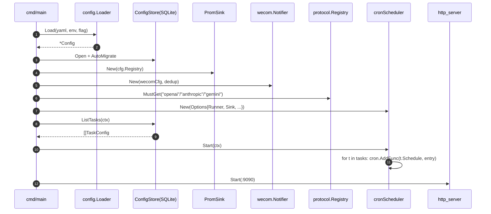
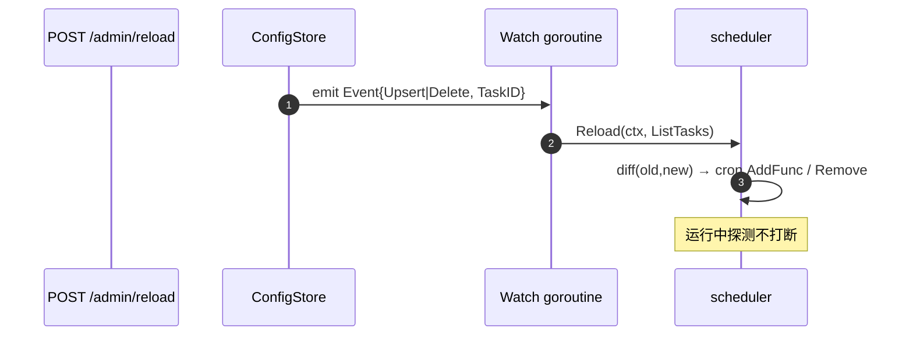
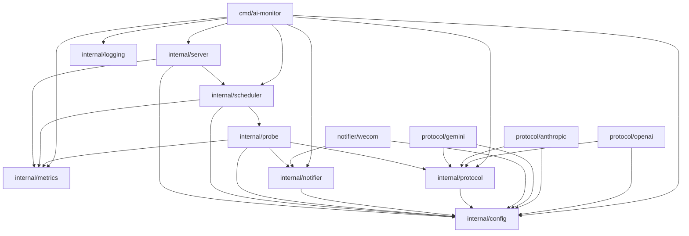
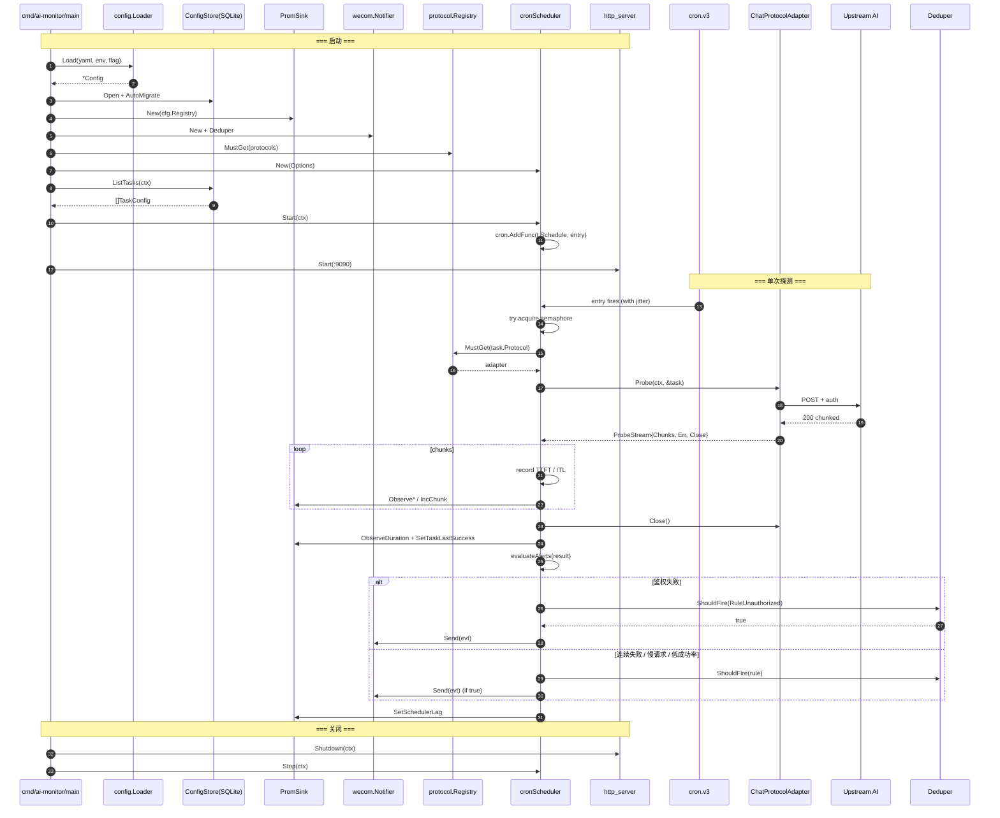
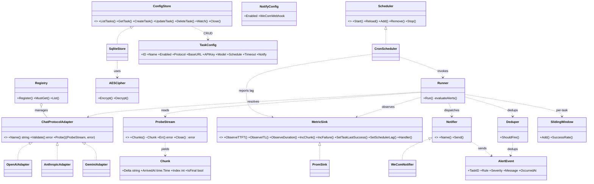

# AI 服务监控与指标统计系统 · 设计方案

> **状态**：设计方案（待用户审阅）
> **阶段**：第一阶段交付（实现前）
> **作者**：许清楚（PRD） + 高见远（架构设计 + 任务分解）
> **汇编**：齐活林（Qi）· 主理人
> **项目根**：`/Users/yangchun/code/gitlab/aibench/ai-monitor`
> **下一步**：用户确认设计后启动寇豆码（工程师）实现 → 严过关（QA）验证

---

## TL;DR

为多协议 AI 端点（OpenAI 兼容 / Anthropic / Gemini）提供**周期性拨测 + 流式时延统计（TTFT / ITL / 会话总时长）+ Prometheus 拉取指标 + 企业微信告警**的单实例 Go 服务。

---

## 目录

- [Part 1 · PRD（许清楚）](#part-1--prd许清楚)
  - [1. 默认技术栈与关键决策](#1-默认技术栈与关键决策)
  - [2. 任务配置字段表](#2-任务配置字段表)
  - [3. 指标 metric 清单](#3-指标-metric-清单)
  - [4. 接口契约（PRD 草签）](#4-接口契约prd-草签)
  - [5. 通知触发规则](#5-通知触发规则)
  - [6. 假设清单（⚠️ 审阅重点）](#6-假设清单-审阅重点)
  - [7. 非目标](#7-非目标)
  - [8. 需求池（P0/P1/P2）](#8-需求池p0p1p2)
- [Part 2 · 架构设计（高见远）](#part-2--架构设计高见远)
  - [9. 最终技术选型（含 go.mod）](#9-最终技术选型含-gomod)
  - [10. 目录结构](#10-目录结构)
  - [11. 包与接口定义（Go 签名）](#11-包与接口定义go-签名)
  - [12. DB Schema](#12-db-schema)
  - [13. 关键流程时序图](#13-关键流程时序图)
  - [14. 模块依赖图](#14-模块依赖图)
  - [15. 实现任务列表](#15-实现任务列表)
  - [16. 跨文件共享约定](#16-跨文件共享约定)
  - [17. 待明确事项 + 风险](#17-待明确事项--风险)
- [附录 A · Mermaid 文件独立产物](#附录-a--mermaid-文件独立产物)

---

# Part 1 · PRD（许清楚）

## 1. 默认技术栈与关键决策

| # | 决策点 | 推荐方案 | 理由 | 替代项 |
|---|---|---|---|---|
| 1 | 配置存储 | **SQLite + GORM** | 任务需要增删改查 + 状态字段 + 审计；单实例零运维；GORM 提供 AutoMigrate 与类型安全 | YAML（静态、轻量、缺事务与运行时变更）；MySQL（多实例协作才需要） |
| 2 | 任务调度 | **robfig/cron v3 + goroutine + 信号量** | 主流库、秒级 cron、内置日志钩子；Go 生态首选 | cron v3 官方包（API 较新）；自研 ticker（需自实现解析与持久化） |
| 3 | 指标采集与上报 | 流式 chunk 回调 → **prometheus/client_golang pull 模式** | 流式天然支持增量；pull 是 Prometheus 标准做法、进程常驻场景契合 | pushgateway（短生命周期任务适用）；OTel exporter（本期不必要） |
| 4 | 多协议可扩展 | **ProtocolAdapter interface + 注册表** | Go 接口天然支持多实现；注册表新增协议零侵入；schema 与协议解耦 | switch on type（紧耦合）；策略模式 + 工厂（样板代码多） |
| 5 | 通知触发 | 连续失败 + 单次慢 + 滑窗成功率三组合 + 去抖 | 单一阈值易抖动；三组合覆盖三类异常 | 仅 HTTP 错误码（漏掉劣化）；纯成功率（漏掉单次严重延迟） |

> 实现语言：**Go 1.25.x**（默认）；请求模式：**强制流式**（ITL 必须从流式 chunk 计算）。

---

## 2. 任务配置字段表

**标记说明**：🌐 公共字段 ｜ 🔌 协议相关字段

| 字段名 | 类型 | 必填 | 默认值 | 说明 | 示例 |
|---|---|---|---|---|---|
| 🌐 id | string (uuid) | 自动生成 | — | 任务唯一标识 | `task-7f3a` |
| 🌐 name | string | 是 | — | 任务显示名，唯一索引 | `prod-gpt4o-probe` |
| 🌐 enabled | bool | 否 | true | 是否启用 | `true` |
| 🌐 protocol | enum | 是 | — | `openai` / `anthropic` / `gemini` | `openai` |
| 🌐 base_url | string | 是 | — | AI 服务 base URL（`url` 校验） | `https://api.openai.com` |
| 🌐 apikey | string (secret) | 是 | — | 鉴权密钥（DB 加密） | `sk-...` |
| 🌐 model | string | 是 | — | 模型名 | `gpt-4o` |
| 🌐 system_prompt | string | 否 | "" | 系统提示，支持 `${var}` | `You are a helpful assistant.` |
| 🌐 user_prompt | string | 是 | — | 用户提示，支持 `${timestamp}` 等变量 | `Say hi at ${timestamp}` |
| 🌐 prompt_vars | map[string]string | 否 | {} | 变量注入映射 | `{"timestamp": "{{.NowRFC3339}}"}` |
| 🌐 schedule | string | 是 | — | cron 表达式（秒级 6 位） | `*/30 * * * * *` |
| 🌐 timeout | duration | 否 | 30s | 单次探测总超时（1s~10m） | `30s` |
| 🌐 notify.enabled | bool | 否 | true | 是否启用通知 | `true` |
| 🌐 notify.channel | enum | 否 | wecom | 通知渠道（本期仅 wecom） | `wecom` |
| 🌐 notify.wecom_webhook | string (secret) | 条件 | — | 企业微信群机器人 webhook（DB 加密） | `https://qyapi.weixin.qq.com/cgi-bin/webhook/send?key=xxx` |
| 🔌 openai.stream_path | string | 否 | `/v1/chat/completions` | OpenAI 流式端点 | `/v1/chat/completions` |
| 🔌 openai.extra_headers | map[string]string | 否 | {} | 自定义请求头 | `{"X-Trace": "1"}` |
| 🔌 anthropic.max_tokens | int | 否 | 1024 | Anthropic 必填 max_tokens（1~200000） | `64` |
| 🔌 gemini.alt | string | 否 | `sse` | Gemini 流式参数（`sse` / `ndjson`） | `sse` |

> 协议段说明：openai/anthropic/gemini 三段根据 `protocol` 字段**互斥启用**；ProtocolAdapter 负责 schema 校验。
> apikey + webhook 用 AES-GCM 加密落 DB，主密钥由 env / flag 注入。

---

## 3. 指标 metric 清单

| Metric 名 | 类型 | 单位 | Labels | Bucket / 用途 |
|---|---|---|---|---|
| `ai_probe_request_duration_seconds` | Histogram | s | `task_id, protocol, model, status` | buckets `[.1, .25, .5, 1, 2, 5, 10, 20, 30, 60]` 会话总时长分布 |
| `ai_probe_ttft_seconds` | Histogram | s | `task_id, protocol, model` | `[.05, .1, .25, .5, 1, 2, 5, 10]` 首 token 延迟分布 |
| `ai_probe_itl_seconds` | Histogram | s | `task_id, protocol, model` | `[.01, .025, .05, .1, .25, .5, 1]` 相邻 token 间隔 |
| `ai_probe_request_total` | Counter | — | `task_id, protocol, model, status` | 探测总次数 |
| `ai_probe_failure_total` | Counter | — | `task_id, protocol, model, error_type` | 失败细分（timeout / 4xx / 5xx / protocol_error） |
| `ai_probe_chunk_total` | Counter | — | `task_id, protocol, model` | 累计接收 chunk 数 |
| `ai_probe_task_last_success_timestamp_seconds` | Gauge | s | `task_id` | 最近一次成功时间（探活 / 看板） |
| `ai_probe_scheduler_lag_seconds` | Gauge | s | `task_id` | 调度延迟（实际执行时间 - 计划时间） |

> **Label cardinality 建议**：`task_id` ≤ 100 量级；`error_type` 用枚举非原始错误文本。
> **Layout 选型**：单实例单任务维度安全；可后续拆分 `task_id` 为 `<protocol>.<model>` 哈希以减小 series。

---

## 4. 接口契约（PRD 草签）

```text
ChatProtocolAdapter
  Name() string
  Validate(cfg TaskConfig) error
  Probe(ctx, cfg) ProbeStream

ProbeStream
  Chunks() <-chan Chunk    // 每个 chunk 带 ArrivedAt + payload
  Err() error              // 流结束时返回最终错误
  Close() error            // 释放连接

ConfigStore
  ListTasks / GetTask / CreateTask / UpdateTask / DeleteTask
  Watch(ctx) <-chan Event  // P1：变更通知

Notifier
  Name() string
  Send(ctx, AlertEvent) error

MetricSink
  ObserveTTFT / ObserveITL / ObserveDuration
  IncFailure / IncChunk
```

> 详细方法签名见 Part 2 §11。

---

## 5. 通知触发规则

| 规则 | 默认阈值 | 理由 |
|---|---|---|
| 连续失败 | 同一任务连续 N=3 次失败 | 容忍偶发抖动；3 次足以确认非随机 |
| 单次严重慢请求 | 会话总时长 > 20s 或 TTFT > 10s | 远超 P99 即视为劣化 |
| 滑窗成功率 | 5 分钟窗口成功率 < 80%（样本 ≥ 20） | 持续劣化但未完全失败 |
| 鉴权失败 | 401 / 403 立即告警（不经连续阈值） | 凭据问题不容缓冲 |
| 通知去抖 | 同一 task_id+rule 5 分钟内仅触发一次 | 避免告警风暴 |
| 恢复通知 | 触发过的任务恢复后发一次 OK（P1） | 闭环 |

> 所有阈值均落地为配置项，**默认配置见 §9 选型表**，用户审阅时可调。

---

## 6. 假设清单（⚠️ 审阅重点）

| # | 假设 | 备选 / 推翻路径 |
|---|---|---|
| A1 | 配置落 SQLite（非 YAML / MySQL） | 改 YAML / MySQL |
| A2 | Prometheus **pull** 模式（非 pushgateway） | 改 pushgateway |
| A3 | 调度最小粒度到**秒**（cron 6 位） | 改 5 位标准 cron |
| A4 | 最大并发探测数 = **16** | 按需调整 |
| A5 | apikey / webhook 在 DB 内 **AES-GCM** 加密 | 可接 KMS |
| A6 | 本期只做**企业微信**一种通知 | 钉钉 / Slack 走 P2 |
| A7 | 历史探测结果不长期存储 | 加 ring buffer |
| A8 | **单实例**部署，不考虑 HA / leader election | 拆调度与执行 |
| A9 | 二进制 + Docker 发布，不打包 Helm | — |
| A10 | ITL 强制要求流式；若协议仅非流式则**降级**——只统计 duration | 转告用户该协议不可用 |

---

## 7. 非目标

- ❌ 不做告警规则引擎（交给 Prometheus Alertmanager）
- ❌ 不做长链路 trace 关联（不接 OTel trace）
- ❌ 不做 dashboard / 可视化（交给 Grafana）
- ❌ 不做多租户 / RBAC
- ❌ 不做云原生自动扩缩
- ❌ 不做协议层代理（只拨测，不转发业务流量）
- ❌ 不做对话式评测 / 答案质量打分

---

## 8. 需求池（P0/P1/P2）

### P0（必须有）
- 三种协议（OpenAI / Anthropic / Gemini）流式探测
- 任务配置 CRUD（SQLite 持久化）
- cron 秒级调度 + 多任务并发 + 并发上限保护
- TTFT / ITL / 会话总时长采集 + Prometheus pull
- 异常通知（企业微信）
- `/metrics` + `/healthz`

### P1（强烈建议）
- 任务启用 / 禁用热切换（无需重启）
- 协议 adapter 配置校验（启动 + 保存双重校验）
- 通知去抖（5min）
- 优雅关闭（drain in-flight）
- 结构化日志（task_id / duration / status 全链路）

### P2（可选）
- Web UI（简单表单管理任务）
- 配置文件导入 / 导出
- 多通知渠道（钉钉 / Slack / Email）
- Pushgateway 模式
- OTel exporter

---

# Part 2 · 架构设计（高见远）

## 9. 最终技术选型（含 go.mod）

| 技术项 | 选型 | 版本 | 理由 / 风险 |
|---|---|---|---|
| 语言 | Go | 1.25.x | slog/slices/maps 标准库齐全；单二进制发布 |
| HTTP 路由 | 标准库 `net/http` + `http.ServeMux` (Go 1.22+ pattern) | stdlib | 固定 3 路由无需框架；零依赖 |
| SQLite 驱动 | `glebarez/sqlite` | v1.11.0 | pure-Go、无 CGO；交叉编译友好 |
| ORM | `gorm.io/gorm` | v1.25.10 | AutoMigrate 省迁移脚本 |
| Cron | `robfig/cron/v3` | v3.0.1 | 秒级支持 + SkipIfStillRunning |
| 并发控制 | `golang.org/x/sync/semaphore` | v0.7.0 | 容量 16；轻量 |
| Prometheus | `prometheus/client_golang` | v1.19.1 | HistogramVec + 自定义 registry |
| 日志 | stdlib `log/slog`（JSON handler） | Go 1.22+ | 零依赖；结构化字段易采集 |
| YAML 解析 | `gopkg.in/yaml.v3` | v3.0.1 | 启动合并 DB 任务配置 |
| 配置校验 | `go-playground/validator/v10` | v10.22.0 | struct tag 校验 |
| UUID | `google/uuid` | v1.6.0 | task_id |
| 加密 | stdlib `crypto/aes` + `cipher.AEAD` | stdlib | AES-256-GCM |
| HTTP 客户端 | stdlib `net/http` | stdlib | SSE 友好 |
| 测试 | stdlib + `stretchr/testify` | v1.9.0 | 断言 |
| Mock | 优先 `httptest.Server`；可备 `go.uber.org/mock` | v0.5.0 | 真实 mock 优先 |

### 完整 `go.mod`

```go
module github.com/aibench/aibench/ai-monitor

go 1.25

require (
    github.com/glebarez/sqlite v1.11.0
    github.com/go-playground/validator/v10 v10.22.0
    github.com/google/uuid v1.6.0
    github.com/prometheus/client_golang v1.19.1
    github.com/robfig/cron/v3 v3.0.1
    github.com/stretchr/testify v1.9.0
    go.uber.org/mock v0.5.0
    golang.org/x/sync v0.7.0
    gopkg.in/yaml.v3 v3.0.1
    gorm.io/gorm v1.25.10
)
```

**未引入**：chi/echo/gin（路由太轻）、zap/logrus（slog 够）、migrate 库（GORM AutoMigrate 够）、viper（yaml+env+flag 三层手动合并）。

**默认参数**：`MaxConcurrent=16`、`SlowThreshold=10s`、`ConsecFailureN=3`、`SuccessRateWindow=200` 样本、`SuccessRateThreshold=0.8`、`DedupTTL=5min`、`Jitter=250ms`、`HTTPAddr=:9090`。

---

## 10. 目录结构

```
ai-monitor/
├── cmd/
│   └── ai-monitor/
│       └── main.go                  # 装配入口：唯一装配点
├── internal/
│   ├── config/
│   │   ├── task.go                  # TaskConfig + 子结构 + 校验
│   │   ├── store.go                 # ConfigStore 接口、Event、Watch
│   │   ├── store_sqlite.go          # GORM 实现 + AutoMigrate
│   │   ├── crypto.go                # AES-GCM 加解密
│   │   └── loader.go                # yaml < env < flag 合并
│   ├── protocol/
│   │   ├── adapter.go               # ChatProtocolAdapter / ProbeStream / Chunk / AlertEvent
│   │   ├── registry.go              # Register / MustGet / List
│   │   ├── openai/                  # OpenAI SSE 流式
│   │   ├── anthropic/               # Anthropic event-stream
│   │   └── gemini/                  # Gemini streamGenerateContent
│   ├── metrics/
│   │   ├── sink.go                  # MetricSink 接口
│   │   └── prom.go                  # PromSink + 自定义 *prometheus.Registry
│   ├── notifier/
│   │   ├── notifier.go              # Notifier 接口 + AlertEvent + MultiNotifier
│   │   ├── dedup.go                 # 5min 去抖
│   │   └── wecom/                   # 企业微信实现
│   ├── probe/
│   │   ├── runner.go                # 编排：adapter→chunk→sink→notifier
│   │   ├── sliding.go               # 滑动窗口成功率
│   │   └── rules.go                 # 4 条告警规则判定
│   ├── scheduler/
│   │   ├── scheduler.go             # Scheduler 接口
│   │   ├── cron.go                  # cron v3 + semaphore + jitter
│   │   └── reload.go                # 热加载（P1）
│   ├── server/
│   │   └── http.go                  # /metrics / /healthz / /admin
│   └── logging/
│       └── slog.go                  # 初始化 + 字段中间件
├── deploy/
│   ├── example.config.yaml
│   ├── prometheus-alerts.yaml
│   └── Dockerfile                   # 多阶段 CGO_ENABLED=0 scratch 镜像
├── Makefile                         # build / test / lint / run / docker
├── go.mod
├── go.sum
└── README.md
```

**职责约束**：
- `cmd/ai-monitor/main.go` 唯一装配入口，禁业务逻辑
- `internal/` 不可被外部 import
- 包名小写无下划线；文件名小写下划线
- 测试文件与被测文件同包同目录

---

## 11. 包与接口定义（Go 签名）

### 11.1 `internal/protocol/adapter.go`

```go
package protocol

// Chunk 单个流式片段。
type Chunk struct {
    Delta     string    // 增量文本
    ArrivedAt time.Time // 到达本进程的时刻（用于 ITL/TTFT 计算）
    Index     int       // 自增，从 0
    IsFinal   bool      // 是否为终止帧
}

type ProbeStream interface {
    Chunks() <-chan Chunk   // Adapter 在内部 goroutine 写入；Close 或 ctx 取消后必须关闭
    Err() error             // 流结束后返回首个非 nil 错误
    Close() error           // 释放连接；幂等
}

type ChatProtocolAdapter interface {
    Name() string                                   // "openai" / "anthropic" / "gemini"
    Validate(cfg *config.TaskConfig) error           // 校验协议段配置
    Probe(ctx context.Context, cfg *config.TaskConfig) (ProbeStream, error)
}

var (
    ErrUnauthorized = errors.New("protocol: unauthorized")          // 401/403，即时告警
    ErrProtocolCfg  = errors.New("protocol: config invalid")        // 配置错误
    ErrUpstreamDown = errors.New("protocol: upstream unavailable")  // 网络/DNS/超时
)
```

### 11.2 `internal/protocol/registry.go`

```go
type AdapterFactory func(deps AdapterDeps) ChatProtocolAdapter

type AdapterDeps struct {
    HTTPClient *http.Client
    UserAgent  string
}

func Register(name string, f AdapterFactory)   // 同名重复 panic
func MustGet(name string, deps AdapterDeps) ChatProtocolAdapter
func List() []string
```

### 11.3 `internal/config/task.go`

```go
type Protocol string
const (
    ProtocolOpenAI    Protocol = "openai"
    ProtocolAnthropic Protocol = "anthropic"
    ProtocolGemini    Protocol = "gemini"
)

type NotifyChannel string
const NotifyWeCom NotifyChannel = "wecom"

type TaskConfig struct {
    ID           string            `gorm:"primaryKey;size:64"`
    Name         string            `gorm:"uniqueIndex;size:128;not null" validate:"required,min=1,max=128"`
    Enabled      bool              `gorm:"not null;default:true"`
    Protocol     Protocol          `gorm:"size:32;not null" validate:"required,oneof=openai anthropic gemini"`
    BaseURL      string            `gorm:"size:512;not null" validate:"required,url"`
    APIKey       string            `gorm:"-"`            // 运行时
    APIKeyEnc    []byte            `gorm:"column:api_key_enc;type:blob"`
    Model        string            `gorm:"size:128;not null" validate:"required"`
    SystemPrompt string            `gorm:"type:text"`
    UserPrompt   string            `gorm:"type:text" validate:"required"`
    PromptVars   map[string]string `gorm:"type:text"`     // JSON
    Schedule     string            `gorm:"size:128;not null" validate:"required"` // cron 6 位
    Timeout      time.Duration     `gorm:"not null;default:30s" validate:"min=1s,max=10m"`
    Notify       NotifyConfig      `gorm:"embedded"`
    OpenAI       *OpenAIConfig     `gorm:"embedded" yaml:"openai,omitempty"`
    Anthropic    *AnthropicConfig  `gorm:"embedded" yaml:"anthropic,omitempty"`
    Gemini       *GeminiConfig     `gorm:"embedded" yaml:"gemini,omitempty"`
    CreatedAt    time.Time         `gorm:"autoCreateTime"`
    UpdatedAt    time.Time         `gorm:"autoUpdateTime"`
}

type NotifyConfig struct {
    Enabled         bool          `gorm:"not null;default:false"`
    Channel         NotifyChannel `gorm:"size:32;not null;default:wecom" validate:"omitempty,oneof=wecom"`
    WeComWebhook    string        `gorm:"-"`
    WeComWebhookEnc []byte        `gorm:"column:wecom_webhook_enc;type:blob"`
}

type OpenAIConfig struct {
    StreamPath        string `gorm:"size:256" validate:"omitempty,startswith=/"`
    ExtraHeadersJSON  string `gorm:"column:openai_extra_headers;type:text"` // JSON 序列化
}

type AnthropicConfig struct {
    MaxTokens        int    `gorm:"not null;default:1024" validate:"min=1,max=200000"`
    ExtraHeadersJSON string `gorm:"column:anthropic_extra_headers;type:text"` // JSON 序列化；用于灰度/Canary 路由头
}

type GeminiConfig struct {
    Alt              string `gorm:"size:32;not null;default:sse" validate:"omitempty,oneof=sse ndjson"`
    ExtraHeadersJSON string `gorm:"column:gemini_extra_headers;type:text"`   // JSON 序列化；用于灰度/Canary 路由头
}
```

### 11.4 `internal/config/store.go`

```go
type EventType string
const (
    EventUpsert EventType = "upsert"
    EventDelete EventType = "delete"
)

type Event struct {
    Type   EventType
    TaskID string
    At     time.Time
}

type ConfigStore interface {
    ListTasks(ctx context.Context) ([]TaskConfig, error)
    GetTask(ctx context.Context, id string) (*TaskConfig, error)
    CreateTask(ctx context.Context, t *TaskConfig) error
    UpdateTask(ctx context.Context, t *TaskConfig) error
    DeleteTask(ctx context.Context, id string) error
    Watch(ctx context.Context) (<-chan Event, error)  // P1：变更订阅
    Close() error
}

var (
    ErrNotFound      = errors.New("config: not found")
    ErrAlreadyExists = errors.New("config: already exists")
    ErrInvalidConfig = errors.New("config: invalid")
)
```

### 11.5 `internal/config/crypto.go`

```go
type Cipher interface {
    Encrypt(plaintext []byte) ([]byte, error)
    Decrypt(ciphertext []byte) ([]byte, error)
}

type AESCipher struct{ aead cipher.AEAD }

func NewAESCipher(masterKey []byte) (*AESCipher, error)  // masterKey 必须 32 字节
func (c *AESCipher) Encrypt(plaintext []byte) ([]byte, error)
func (c *AESCipher) Decrypt(ciphertext []byte) ([]byte, error)
// 落盘格式：nonce(12) || ciphertext || tag(16)
```

### 11.6 `internal/metrics/sink.go`

```go
type MetricSink interface {
    ObserveTTFT(taskID, protocol, model string, seconds float64)
    ObserveITL(taskID, protocol, model string, seconds float64)
    ObserveDuration(taskID, protocol, model, status string, seconds float64)
    IncChunk(taskID, protocol, model string, n int)
    IncFailure(taskID, protocol, model, errorType string)
    SetTaskLastSuccess(taskID string, ts time.Time)
    SetSchedulerLag(seconds float64)
    Handler() http.Handler
}
```

**PromSink 内部 8 指标**（独立 `*prometheus.Registry`，避免重复注册）：
- `ai_probe_request_duration_seconds`（HistogramVec {task_id, protocol, model, status}）
- `ai_probe_ttft_seconds`（HistogramVec {task_id, protocol, model}）
- `ai_probe_itl_seconds`（HistogramVec {task_id, protocol, model}）
- `ai_probe_request_total`（CounterVec {task_id, protocol, model, status}）
- `ai_probe_failure_total`（CounterVec {task_id, protocol, model, error_type}）
- `ai_probe_chunk_total`（CounterVec {task_id, protocol, model}）
- `ai_probe_task_last_success_timestamp_seconds`（GaugeVec {task_id}）
- `ai_probe_scheduler_lag_seconds`（Gauge）

默认 Histogram buckets：`{.005, .01, .025, .05, .1, .25, .5, 1, 2.5, 5, 10, 30}`。

**11.6.1（用户问题触发的设计补丁）— 分位数计算与 buckets 优化**

Histogram 类型原生支持 PromQL 的 `histogram_quantile(quantile, sum by (le) (rate(...[5m])))` 计算 P50/P90/P95/P99 趋势图，配套 Grafana Dashboard 见 `deploy/grafana-llm-dashboard.json`。

但默认单套 buckets 在以下场景精度不足，建议在 P1-D 拆分：

| 指标 | 推荐 buckets | 理由 |
|---|---|---|
| `ai_probe_ttft_seconds` | `{.01, .025, .05, .1, .2, .35, .5, .75, 1, 2, 5}` | TTFT P99 通常 ≤ 1s，应在 1s 附近加密 |
| `ai_probe_itl_seconds` | `{.005, .01, .025, .05, .1, .25, .5}` | ITL 期望 ≤ 50ms |
| `ai_probe_request_duration_seconds` | `{.1, .25, .5, 1, 2.5, 5, 10, 20, 30, 60, 120}` | 会话总时长在长上下文下 P99 可达 30s+ |
| `ai_probe_scheduler_lag_seconds` | 升级为 Histogram（沿用 `{.01, .05, .1, .5, 1, 5, 30, 60}`） | 便于 P95 调度延迟计算 |

**11.6.2 — 可选 label：`canary_group`**（与 §17.1 第 1 项联动）

若启用灰度流量测试，建议给所有 `*Vec` 指标加 label `canary_group string`，默认 `"default"`。灰度任务配置时设定该值（如 `"gray-2024q3"` / `"prod"`），PromQL 可直接 split 出对比曲线：

```promql
histogram_quantile(0.95,
  sum by (le, protocol, model, canary_group) (
    rate(ai_probe_ttft_seconds_bucket[5m])
  )
)
```

> Cardinality 影响：每个任务增加 1 个 label 维度，若 task_id < 100 量级可控。

### 11.7 `internal/notifier/notifier.go`

```go
type AlertSeverity string
const (
    SeverityInfo     AlertSeverity = "info"
    SeverityWarning  AlertSeverity = "warning"
    SeverityCritical AlertSeverity = "critical"
)

type AlertRule string
const (
    RuleConsecFailure  AlertRule = "consecutive_failures"
    RuleSlowRequest    AlertRule = "slow_request"
    RuleSuccessRateLow AlertRule = "success_rate_below_80"
    RuleUnauthorized   AlertRule = "unauthorized_immediate"
)

type AlertEvent struct {
    TaskID     string
    TaskName   string
    Protocol   string
    Rule       AlertRule
    Severity   AlertSeverity
    Message    string
    OccurredAt time.Time
    Meta       map[string]string
}

type Notifier interface {
    Name() string
    Send(ctx context.Context, evt AlertEvent) error
}

type MultiNotifier struct{ notifiers []Notifier }  // P1 预留
```

### 11.8 `internal/notifier/dedup.go`

```go
type Deduper struct {
    ttl time.Duration
    mu  sync.Mutex
    m   map[string]time.Time
}

func NewDeduper(ttl time.Duration) *Deduper
func (d *Deduper) ShouldFire(key string, now time.Time) bool
// Dedup key = task_id + ":" + rule；5min 内仅触发一次
```

### 11.9 `internal/scheduler/scheduler.go`

```go
type Scheduler interface {
    Start(ctx context.Context) error
    Reload(ctx context.Context, tasks []config.TaskConfig) error  // P1
    Add(task config.TaskConfig) error
    Remove(taskID string) error
    Stop(ctx context.Context) error
}
```

### 11.10 `internal/scheduler/cron.go` 关键结构

```go
type cronScheduler struct {
    cron     *cron.Cron
    sem      *semaphore.Weighted
    runner   *probe.Runner
    sink     metrics.MetricSink
    logger   *slog.Logger
    jitter   time.Duration
    inflight sync.WaitGroup
}
```

### 11.11 `internal/probe/probe.go`

```go
type Result struct {
    TaskID    string
    TaskName  string
    Protocol  string
    Model     string
    StartedAt time.Time
    EndedAt   time.Time
    TTFT      time.Duration     // 0 表示无 chunk
    ITLSum    time.Duration
    ITLCount  int
    Chunks    int
    Status    string            // "success" / "failure" / "unauthorized"
    Err       error
}

type Runner struct {
    adapters                protocol.Registry
    sink                    metrics.MetricSink
    notifier                notifier.Notifier
    dedup                   *notifier.Deduper
    sliders                 sync.Map           // task_id -> *slidingWindow
    slowThreshold           time.Duration      // 默认 10s
    consecFailureN          int                // 默认 3
    successRateWindow       int                // 默认 200
    successRateThreshold    float64            // 默认 0.8
}

func (r *Runner) Run(ctx context.Context, t config.TaskConfig) Result
// 步骤：
//   1. registry.MustGet(t.Protocol)
//   2. adapter.Probe(ctx, &t) → ProbeStream
//   3. 读 Chunks：记录 TTFT / ITL
//   4. Close → 记录 Duration
//   5. sink.Observe* 上报
//   6. evaluateAlerts → notifier.Send
```

### 11.12 `internal/server/http.go`

```go
type Server struct { /* cfg + store + scheduler + sink + logger + http.Server */ }

func (s *Server) Start(ctx context.Context) error
func (s *Server) Shutdown(ctx context.Context) error

// 路由：
//   GET  /metrics         → sink.Handler()
//   GET  /healthz         → 200 / 503（DB ping + 最近 cron 触发时间）
//   GET  /admin/tasks     → store.ListTasks（dev bind）
//   POST /admin/reload    → scheduler.Reload（dev bind）
// 默认监听：:9090
```

---

## 12. DB Schema

```go
// GORM AutoMigrate，启用 WAL + busy_timeout
db, _ := gorm.Open(sqlite.Open(
    "file:ai-monitor.db?_pragma=journal_mode(WAL)&_pragma=busy_timeout(5000)",
    &gorm.Config{},
))
db.AutoMigrate(&TaskConfig{})  // 单表，含 embedded Notify / OpenAI / Anthropic / Gemini
```

**生成的 `tasks` 表关键字段**：

```sql
CREATE TABLE tasks (
    id              VARCHAR(64)  PRIMARY KEY,
    name            VARCHAR(128) NOT NULL UNIQUE,
    enabled         BOOLEAN      NOT NULL DEFAULT 1,
    protocol        VARCHAR(32)  NOT NULL,
    base_url        VARCHAR(512) NOT NULL,
    api_key_enc     BLOB,
    model           VARCHAR(128) NOT NULL,
    system_prompt   TEXT,
    user_prompt     TEXT,
    prompt_vars     TEXT,                                    -- JSON
    schedule        VARCHAR(128) NOT NULL,
    timeout_seconds INTEGER      NOT NULL DEFAULT 30,
    notify_enabled  BOOLEAN      NOT NULL DEFAULT 0,
    notify_channel  VARCHAR(32)  NOT NULL DEFAULT 'wecom',
    wecom_webhook_enc BLOB,
    openai_stream_path      VARCHAR(256),
    openai_extra_headers    TEXT,                            -- JSON
    anthropic_max_tokens    INTEGER      DEFAULT 1024,
    gemini_alt              VARCHAR(32)  DEFAULT 'sse',
    created_at  DATETIME,
    updated_at  DATETIME
);
```

---

## 13. 关键流程时序图

### 13.1 启动加载



### 13.2 单次探测

```mermaid
sequenceDiagram
    autonumber
    participant Cron as cron.v3
    participant Sch as scheduler
    participant Sem as semaphore
    participant Run as probe.Runner
    participant Reg as Registry
    participant Adp as ChatProtocolAdapter
    participant HTTP as Upstream AI
    participant Sink as PromSink
    participant Notif as Notifier
    participant Dedup as Deduper

    Cron->>Sch: entry fires (with jitter)
    Sch->>Sem: Acquire(ctx, 1)
    Sem-->>Sch: ok
    Sch->>Run: Run(ctx, task)
    Run->>Reg: MustGet(task.Protocol)
    Reg-->>Run: adapter
    Run->>Adp: Probe(ctx, &task)
    Adp->>HTTP: POST + auth
    HTTP-->>Adp: 200 chunked
    Adp-->>Run: ProbeStream
    loop 读 Chunks
        Run->>Run: first chunk? → TTFT = now - startedAt
        Run->>Run: prev != nil? → ITL = now - prev
        Run->>Sink: ObserveTTFT / ObserveITL / IncChunk
    end
    Run->>Adp: Close()
    Run->>Run: Duration; Status = success/failure/unauthorized
    Run->>Sink: ObserveDuration + SetTaskLastSuccess
    Run->>Run: evaluateAlerts(task, result)
    alt 鉴权失败
        Run->>Dedup: ShouldFire(RuleUnauthorized)
        Dedup-->>Run: true
        Run->>Notif: Send(AlertEvent)
    else 连续失败 / 慢请求 / 低成功率
        Run->>Dedup: ShouldFire(rule)
        Run->>Notif: Send(AlertEvent) if true
    end
    Run->>Sem: Release(1)
    Run->>Sink: SetSchedulerLag
```

### 13.3 热更新（P1）



---

## 14. 模块依赖图



**Import 方向约束**（写入 Makefile lint 阶段 + depguard）：
- `protocol/*` → `protocol` → `config`（最底层）
- `metrics` 仅依赖 stdlib + prom client
- `notifier` 仅依赖 `config` + `notifier/wecom`
- `probe` 可依赖所有下层
- `scheduler` 可依赖 `probe + metrics + config`
- `server` 可依赖 `config + metrics + scheduler`
- `main` 是唯一装配入口

**禁止反向依赖**（lint 强制）。

---

## 15. 实现任务列表

> **强约束**：19 个任务（P0=14 + P1=5），远低于 30 上限；每个任务独立可提交；TDD 流程（红→绿→重构）。
> **首任务必为项目骨架**；最后任务为收尾。
> **新增**：
> - P1-C「协议级 ExtraHeaders 收口」用于支持 AI 端点的**灰度流量测试**（Canary 路由 / 租户路由 / A/B 对比）。
> - P1-D「Histogram 指标分桶拆分 + scheduler_lag 升级 Histogram」用于让 P50/P90/P95/P99 分位数趋势图精度达标。

### 15.1 任务总览

| ID | 标题 | 分区 | 依赖 | 优先级 |
|---|---|---|---|---|
| A1 | 项目骨架（go.mod/Makefile/Hello HTTP） | A | — | P0 |
| B1 | 配置加载与合并（yaml+env+flag） | B | A1 | P0 |
| B2 | SQLite + GORM 迁移 + TaskConfig 模型 | B | B1 | P0 |
| B3 | AES-GCM 加密 + ConfigStore CRUD + Watch | B | B2 | P0 |
| C1 | adapter interface + registry + sentinel errors | C | B2 | P0 |
| C2 | OpenAI 适配器（SSE） | C | C1 | P0 |
| C3 | Anthropic 适配器（event-stream） | C | C1 | P0 |
| C4 | Gemini 适配器（streamGenerateContent） | C | C1 | P0 |
| D1 | MetricSink interface + PromSink（8 指标） | D | A1 | P0 |
| E1 | scheduler cron + semaphore + jitter | E | C2,C3,C4,D1 | P0 |
| F1 | Notifier 接口 + wecom 实现 + Deduper | F | B3 | P0 |
| G1 | probe.runner + 滑动窗口 + 规则评估 | G | C1,D1,F1 | P0 |
| G2 | HTTP 服务（/metrics + /healthz + /admin） | G | E1,G1,D1 | P0 |
| H1 | 端到端集成测试 | H | G2 | P0 |
| I1 | 收尾（README/示例/告警规则/Dockerfile） | I | H1 | P0 |
| P1-A | 热加载（Watch → Reload） | P1 | G2 | P1 |
| P1-B | 协议校验 + 结构化日志 + 优雅关闭 | P1 | G2 | P1 |
| P1-C | 协议级 ExtraHeaders 收口（OpenAI/Anthropic/Gemini 全量） + 灰度用例示例 | P1 | C2,C3,C4 | P1 |
| P1-D | Histogram 分桶拆分 + scheduler_lag 升 Histogram + canary_group label（精度支撑 P50/P90/P95/P99） | P1 | D1 | P1 |

### 15.2 详细任务卡（关键 P0）

#### **A1 · 项目骨架**（2-5 分钟）
- **文件**：`go.mod`、`go.sum`、`Makefile`、`internal/logging/slog.go`、`cmd/ai-monitor/main.go`、`internal/server/http.go`（最小版仅 `/healthz`）
- **步骤**：
  1. `go mod init` + 写入 §9 全部依赖 + `go mod tidy`
  2. `Makefile`：build / test / lint / run / docker
  3. `internal/logging/slog.go` 初始化 JSON handler
  4. `cmd/main.go` 启动 `:9090` 返回 "ok"
- **测试**：
  - ❌ `TestHealthz_Ok`：`/healthz` 期待 200 + body "ok"

#### **B1 · 配置加载与合并**（2-5 分钟）
- **文件**：`internal/config/loader.go` + `loader_test.go` + `deploy/example.config.yaml`
- **步骤**：定义 `Config{MasterKey, SQLitePath, MaxConcurrent, Jitter, HTTPAddr, SlowThreshold, ConsecFailureN, SuccessRateWindow, SuccessRateThreshold}`；`Load(yamlPath)`：yaml < env < flag 覆盖
- **测试**：
  - ❌ `TestLoad_YAMLOnly` / `TestLoad_EnvBeatsYAML` / `TestLoad_FlagBeatsAll` / `TestLoad_MissingMasterKey`

#### **B2 · SQLite + GORM**（2-5 分钟）
- **文件**：`internal/config/task.go` + `store_sqlite.go` + tests
- **步骤**：§11.3 struct + gorm tag；`Open(path)` 启用 WAL+busy_timeout；`AutoMigrate`
- **测试**：
  - ❌ `TestAutoMigrate_CreatesTasksTable`
  - ❌ `TestTaskConfig_RoundTrip`

#### **B3 · AES-GCM + ConfigStore CRUD + Watch**（5 分钟）
- **文件**：`crypto.go` + `store.go` + `store_sqlite.go` 补全 + tests
- **步骤**：`AESCipher` nonce(12)||ct||tag；CRUD 6 方法；`Watch` poll 5s 去重
- **测试**：
  - ❌ `TestAESCipher_RoundTrip` / `TestAESCipher_WrongKeyFail`
  - ❌ `TestConfigStore_CRUD` / `TestConfigStore_UniqueName` / `TestConfigStore_Watch`

#### **C1 · adapter interface + registry + sentinel**（5 分钟）
- **文件**：`adapter.go` + `registry.go` + `adapter_test.go`
- **步骤**：§11.1 / §11.2；sentinel errors
- **测试**：
  - ❌ `TestRegistry_RegisterOverwrite`（panic）
  - ❌ `TestRegistry_MustGetUnknown`（panic）
  - ❌ `TestRegistry_Concurrent`（`-race` 通过）

#### **C2 · OpenAI 适配器**（5-10 分钟）
- **步骤**：SSE 解析（`event:` + `data:` 行；`data: [DONE]` 终止）；401/403 → `ErrUnauthorized`
- **测试**：
  - ❌ `TestOpenAI_Probe_Success`（5 chunk + IsFinal + chan close）
  - ❌ `TestOpenAI_Probe_Unauthorized`
  - ❌ `TestOpenAI_Probe_Timeout`（ctx 取消不阻塞）
  - ❌ `TestOpenAI_Validate_InvalidPath`

#### **C3 · Anthropic 适配器**（5-10 分钟）
- **步骤**：解析 `event: content_block_delta` 的 `data.delta.text`；`message_stop` 终止
- **测试**：3 条同 C2 形态

#### **C4 · Gemini 适配器**（5-10 分钟）
- **步骤**：`streamGenerateContent` 解析 JSON 数组流；`finishReason != ""` 终止
- **测试**：3 条同 C2 形态

#### **D1 · MetricSink + PromSink**（5 分钟）
- **步骤**：§11.6 接口 + 8 指标 + 独立 `*prometheus.Registry`；buckets 默认值
- **测试**：
  - ❌ `TestPromSink_ObserveTTFT_IncrementsBuckets`
  - ❌ `TestPromSink_AllMetricsRegistered`（8 families）
  - ❌ `TestPromSink_HandlerReturnsValid`

#### **E1 · scheduler cron + semaphore + jitter**（5-10 分钟）
- **步骤**：`cron.New(cron.WithSeconds(), cron.WithChain(cron.SkipIfStillRunning))`；`semaphore.Weighted`；jitter 0~Jitter；Start/Stop/Add/Remove/Reload
- **测试**：
  - ❌ `TestScheduler_FiresEntry`（fake clock）
  - ❌ `TestScheduler_MaxConcurrent`（第 17 个 fail-fast）
  - ❌ `TestScheduler_Remove`

#### **F1 · Notifier + wecom + Deduper**（5 分钟）
- **步骤**：Notifier + AlertEvent + MultiNotifier；wecom POST markdown；Deduper 5min TTL
- **测试**：
  - ❌ `TestWeCom_Send_Success`（POST body 含 `task_id`）
  - ❌ `TestWeCom_Send_RetryableError`（500 → error）
  - ❌ `TestDeduper_FirstFireReturnsTrue` / `TestDeduper_DedupWithinTTL`

#### **G1 · probe runner + 滑动窗口 + 规则评估**（5-10 分钟）
- **步骤**：§11.11 Runner；Run 步骤 1-6；slidingWindow + SuccessRate；evaluateAlerts 4 条规则 + 去抖 + notify.Enabled
- **测试**：
  - ❌ `TestRunner_TTFTItChDuration`（mock 3 chunk 全调 Observe*）
  - ❌ `TestRunner_UnauthorizedImmediate`
  - ❌ `TestRunner_ConsecutiveFailures`（连续 3 + 第 4 次 5min 内抑制）
  - ❌ `TestRunner_SlowRequest` / `TestRunner_SlidingWindow_LowSuccessRate`
  - ❌ `TestRunner_NotifyDisabled`

#### **G2 · HTTP 服务**（5 分钟）
- **步骤**：3 路由 + 优雅 Shutdown（5s 超时）
- **测试**：
  - ❌ `TestHTTP_Metrics`（含 `ai_probe_request_duration_seconds`）
  - ❌ `TestHTTP_Healthz_Ok` / `TestHTTP_Healthz_DBDown`
  - ❌ `TestHTTP_AdminTasks`

#### **H1 · 端到端集成**（5-10 分钟）
- **步骤**：启子进程 + httptest mock + 1 周期断言 `/metrics`
- **测试**：
  - ❌ `TestE2E_ProbeFiresAndMetricsExposed`（`-tags=integration`）
  - ❌ `TestE2E_AlertSent`（连续失败 3 次 → wecom mock 收到 POST）

#### **I1 · 收尾**（5 分钟）
- **步骤**：README + `example.config.yaml` + `prometheus-alerts.yaml`（5 条规则样例）+ `Dockerfile`（多阶段 CGO_ENABLED=0 + scratch）
- **测试**：
  - ❌ `TestDockerfile_Builds` / `TestPromAlerts_YAMLLint`

#### **P1-A · 热加载**（5 分钟）
- **步骤**：Watch goroutine → diff(old,new) → cron.AddFunc/Remove
- **测试**：`TestReload_AddsNewTask` / `TestReload_RemovesDeletedTask`

#### **P1-B · 协议校验 + 结构化日志 + 优雅关闭**（5 分钟）
- **步骤**：slog task_id 注入；server.Shutdown 等 in-flight；main 优雅退出；协议段 Validate 互斥强制
- **测试**：`TestLogging_TaskIDInContext` / `TestGracefulShutdown_StopsWithinTimeout` / `TestValidate_MutuallyExclusiveProtocols`

#### **P1-C · 协议级 ExtraHeaders 收口（灰度流量测试）**（5 分钟）
- **目的**：让 OpenAI / Anthropic / Gemini 三种协议全部支持自定义请求头，支撑**灰度（Canary）流量测试**场景
- **文件**：`internal/config/task.go`（扩展 AnthropicConfig / GeminiConfig 字段）、`internal/protocol/openai/openai.go`（注入 ExtraHeaders）、`internal/protocol/anthropic/anthropic.go`（同）、`internal/protocol/gemini/gemini.go`（同）、`deploy/canary-scenarios.yaml`（示例）、各适配器测试
- **步骤**：
  1. 在三协议的 config 结构体补 `ExtraHeadersJSON`（OpenAI 已有，Anthropic / Gemini 新增）
  2. `AdapterDeps` 增加 `ExtraHeaders map[string]string` 注入（启动时由 Runner 从 cfg 解码 JSON 后传入）
  3. 三协议 Probe 实现：在 `http.NewRequestWithContext` 之后遍历 ExtraHeaders 调用 `req.Header.Set`
  4. Header 注入顺序（防被覆盖）：先 `Authorization` 等鉴权头 → 再 `User-Agent` → 最后用户 ExtraHeaders（允许覆盖）
  5. 在 `deploy/canary-scenarios.yaml` 写入典型示例（同域名灰度 / 跨实例对比 / 租户级）
- **测试**（TDD）：
  - ❌ `TestOpenAI_Probe_SendsExtraHeaders`：httptest.Server 断言收到 `X-Canary: gray`
  - ❌ `TestOpenAI_Probe_AuthHeaderNotOverridden`：ExtraHeaders 含 `Authorization` 时与 apikey 冲突报错（避免凭据泄漏）
  - ❌ `TestAnthropic_Probe_SendsExtraHeaders`
  - ❌ `TestGemini_Probe_SendsExtraHeaders`
  - ❌ `TestExtraHeaders_BlackList`：拒绝对 `Host` / `Content-Length` 等系统头设置
- **依赖**：C2, C3, C4

#### **P1-D · Histogram 分桶拆分 + scheduler_lag 升 Histogram + canary_group label**（5 分钟）
- **目的**：让 P50/P90/P95/P99 趋势图的精度满足生产要求（解决默认值下 duration P99 边界饱和、TTFT 桶太粗、scheduler_lag 不可分位数）
- **文件**：`internal/metrics/prom.go`（每指标独立 buckets）、`internal/config/task.go`（TaskConfig 加 `CanaryGroup`）、Prometheus 注册表改造、各 label 维度同步测试
- **步骤**：
  1. `Config` 加 `BucketsTTFT/BucketsITL/BucketsDuration/BucketsLag` 4 个 `[]float64`，默认按 §11.6.1
  2. `PromSink` 构造时按指标分别传入各自 buckets（不再共用）
  3. `scheduler_lag_seconds` 升级为 HistogramVec
  4. 所有 HistogramVec/CounterVec/GaugeVec 的 Labels 增加 `canary_group`，默认 `"default"`
  5. `Sink.Observe*`/`Inc*`/`Set*` 入参加 canary_group 透传
- **测试**（TDD）：
  - ❌ `TestPromSink_DurationP99At60s`：构造样本 100% 在 60s，断言 histogram_quantile(0.99) ≈ 60 不饱和
  - ❌ `TestPromSink_TTFTBuckets`：断言 bucket 顺序与 §11.6.1 一致
  - ❌ `TestPromSink_CanaryGroupLabel`：canary_group=gray 时分裂为独立 series
  - ❌ `TestPromSink_SchedulerLagHistogram`：断言 PromSink 注册了 lag 的 HistogramVec
- **依赖**：D1
- **配套产出**：`deploy/grafana-llm-dashboard.json`（已带 P50/P90/P95/P99 趋势面板）+ `deploy/llm-promql-examples.md`（已提供全部 PromQL 模板）

---

## 16. 跨文件共享约定

| 类别 | 约定 |
|---|---|
| **错误处理** | sentinel error 集中在包顶部；一律 `fmt.Errorf("op ctx: %w", err)`；用 `errors.Is/As`；禁字符串比较 |
| **日志** | `log/slog` + JSON；字段固定 `task_id / task_name / protocol / model / status / duration_ms / chunk_count / ttft_ms / itl_ms / error`；ctx 注入 task_id |
| **上下文** | ctx 必须携带 task_id（自定义 key 类型防冲突）；丢时在 runner 入口 upsert；所有 IO 必须接收 ctx |
| **配置注入** | `default < config.yaml < env (AI_MONITOR_*) < flag`；flag 仅启动期；DB 任务配置走热加载 |
| **时区** | DB 写 UTC；cron 解析用本地时区（`TZ` env 控制）；日志 RFC3339Nano + 时区标识 |
| **命名** | 包名小写无下划线；接口 `er / Store / Adapter` 结尾；文件小写下划线；变量驼峰；常量全大写下划线分词 |
| **并发** | 共享状态用 `sync.RWMutex` 或 `atomic`；测试一律 `-race` |
| **加密** | master key 仅 env / flag，绝不落盘 / 进日志；含 api_key 的错误日志 redact；启动后清零内存变量 |
| **版本** | 依赖锁 minor 不锁 patch；go 1.25 toolchain 锁定 |
| **Makefile 钩子** | lint = `go vet` + `golint` + `depguard`（强制 import 方向） |

---

## 17. 待明确事项 + 风险

### 17.1 待用户拍板（≥5）

1. **灰度（Canary）流量测试支持范围**（⚠️ **新增项，用户原始需求触发的设计补丁**）：是否启用 P1-C「协议级 ExtraHeaders 收口」？主要用途是同域名 Header 触发网关路由、跨实例 A/B 对比、租户级灰度，还是别的场景？是否需要在 metrics label 上新增 `canary_group` 维度方便对比？
2. **Master Key 来源**：env `AI_MONITOR_MASTER_KEY` 还是 K8s Secret 挂载？是否需要密钥轮转？
3. **HTTP 服务端口与绑定**：默认 `:9090` 是否绑 `0.0.0.0`？`/admin` 是否需要 basic auth / token？
4. **SQLite 驱动**：是否接受 pure-Go `glebarez/sqlite`？是否需 CGO 版追求极致写入？
5. **DB 加密字段**：仅加密 api_key + webhook？还是扩到 user_prompt（防提示词泄漏）？
6. **告警扩展性**：预留 Slack / Email / generic webhook（当前仅 MultiNotifier 骨架）？
7. **任务并发**：默认 16 是否需要按 task 单独限流？
8. **历史结果**：是否需要本地落盘最近 N 次用于事后排查？
9. **部署形态**：Docker 镜像 + systemd unit 示例是否一起发布？
10. **TLS**：HTTP 客户端到 AI 上游是否需要 mTLS / 自签证书跳过？
11. **协议扩展**：Azure / Bedrock / 国产模型是否预留可插拔 HTTP 模板层？

### 17.2 技术风险（≥5）

| 风险 | 兜底 |
|---|---|
| SQLite 写并发瓶颈 | WAL + busy_timeout；不行则串行化写入队列 + 单 goroutine 提交 |
| 流式响应阻塞 | Chunks chan buffered 256；超过即丢弃（chunk_count 仍计） |
| Cron 雪崩 | jitter 0~250ms；撞信号量 fail-fast + scheduler_lag 上报 |
| 企微 webhook 失败 | 当前不重试；P1 落 `failed_alerts.db` + 日志告警 |
| apikey 泄漏 | master key 启动后立即清零内存变量 |
| Prom label cardinality | 启动校验 task_id 总量，超阈值 fail-fast |
| scheduler_lag 漂移 | lag 用 monotonic clock；上报换 wall clock |
| 优雅停机超时 | 默认 5s；超时后强制退出 + 落未完成任务日志 |
| HTTP/2 上游 | transport 强制配置 h2 |
| 热加载一致 | Reload 用 mutex 串行化 + 内部 version 号防 race |

---

# 附录 A · Mermaid 文件独立产物

## A.1 sequence-diagram.mermaid



## A.2 class-diagram.mermaid



---

> **设计方案到此结束 — 等用户审阅并明确 §17.1 中的待拍板事项后，将启动第二阶段（寇豆码·工程师实现）。**
